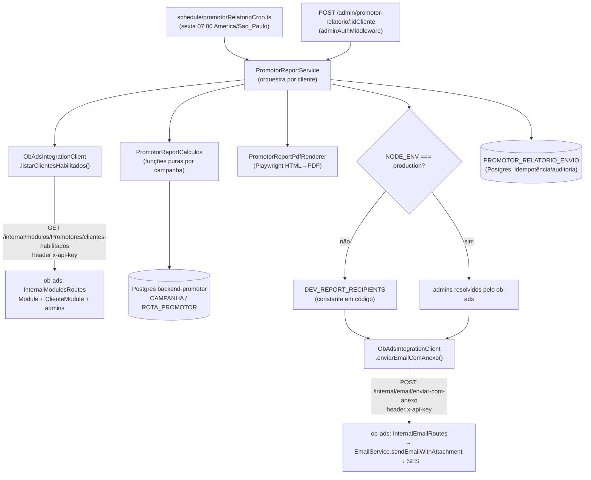

# Relatório Semanal de Promotores Design

**Spec**: `.specs/features/relatorio-semanal-promotores/spec.md`
**Status**: Draft

**Escopo cross-repo**: esta feature toca dois repositórios com deploy independente — `backend-promotor` (todo o cálculo, PDF, cron, endpoint manual) e `backend-ob-ads` (2 endpoints internos novos, genéricos, reaproveitando `EmailService` e `Module/ClienteModule` já existentes). A fase Tasks deve sequenciar isso: endpoints do ob-ads primeiro, backend-promotor depois (ver Risco 4).

---

## Architecture Overview

O backend-promotor é o dono de todo o cálculo (dados vivem no Postgres dele) e da renderização do PDF. O backend-ob-ads é só "serviço de infraestrutura" pra duas coisas que já tem prontas e o backend-promotor não tem: saber quem é admin de um cliente, e mandar e-mail via SES. A guarda dev/produção (RELPROM-28 a 31) vive inteiramente no backend-promotor — o ob-ads nunca decide "pra quem" mandar, só manda pra lista que recebe.



---

## Code Reuse Analysis

### Existing Components to Leverage

| Component | Location | How to Use |
| --- | --- | --- |
| `listarCampanhasAtivas` (critério de campanha ativa) | `service/adminDisparoService.ts:178-208` | Reaproveitar a mesma condição (`STATUS='PUBLICADA' AND DELETED_AT IS NULL AND START_TIME<=agora AND (END_TIME IS NULL OR END_TIME>=agora)`) em vez de inventar um critério novo |
| `adminAuthMiddleware` | `middlewares/adminAuthMiddleware.ts` | Protege o novo endpoint manual, conforme AD-004 |
| `createDocumentedRoute` + padrão `router.use(adminAuthMiddleware)` + `responder()` | `routes/AdminDisparoRoute.ts:18-46` | Modelo exato pra declarar a rota nova, validar com zod e envelopar erro/sucesso |
| `node-cron` + guarda `NODE_ENV==="test"` + flag `*_ENABLED==="1"` + lock de sobreposição | `schedule/outboxNotificacaoCron.ts:30-32,48-84`, registrado em `app.ts:53` | Modelo exato pro cron novo (`PROMOTOR_RELATORIO_ENABLED`) |
| `AppDataSourceSync` / `data-source.ts` | `data-source.ts` | Acesso ao Postgres pra `ROTA_PROMOTOR`/`CAMPANHA`/`CAMPANHA_PROMOTOR` |
| Playwright (dependência já presente, `package.json:56`, `^1.56.0`) | — | Primeiro uso real no repo (zero uso hoje) — renderizar HTML→PDF |
| `EmailService.sendEmailWithAttachment` | `backend-ob-ads/src/appplication/services/EmailService.ts:115-153` | Reaproveitado via novo endpoint interno fino, não reimplementado |
| Padrão de guarda de rota interna (`apiKeyGuard`, header `x-api-key`) | `backend-ob-ads/src/main/config/routes/CommunityReportInternalRoutes.ts:9-19` | Modelo exato de auth pros 2 endpoints internos novos |
| Query de resolução de `Usuario` por `idCliente` (M:N `USUARIO_X_CLIENTES` + direto) | `backend-ob-ads/src/appplication/services/communityReport/CommunityReportEmailService.ts:221-233` | Extrair pra uma função reaproveitável, invertendo `IS_ADMIN` (`=1` em vez de `IS NULL OR =0`), mantendo a exclusão de `@oficinabrasil.com.br` |
| Padrão de leitura de env "a cada chamada" (não cachear em const de módulo) | `CommunityReportEmailService.ts:62-70,86-88` | Mesmo cuidado pro `DEV_REPORT_RECIPIENTS`/checagem de `NODE_ENV`, por causa de `dotenv.config()` tardio |
| `Module` / `ClienteModule` | `backend-ob-ads/src/domain/entities/{Module,ClienteModule}.ts` | Existência de linha em `cliente_module` apontando pro módulo = "habilitado"; sem coluna de enabled |

### Integration Points

| Sistema | Método de integração |
| --- | --- |
| backend-ob-ads (SQL Server: `Module`, `ClienteModule`, `Usuario`) | `GET /internal/modulos/:nomeModulo/clientes-habilitados` (novo) |
| backend-ob-ads (SES via `EmailService`) | `POST /internal/email/enviar-com-anexo` (novo) |
| Postgres do backend-promotor (`CAMPANHA`, `CAMPANHA_PROMOTOR`, `ROTA_PROMOTOR`) | TypeORM, mesmas entities já existentes |
| Postgres do backend-promotor (auditoria/idempotência) | Nova tabela `PROMOTOR_RELATORIO_ENVIO` (migration manual, script `.sql`) |

---

## Components

### PromotorReportService
- **Purpose**: Orquestra a geração do relatório de um cliente — busca campanhas ativas, delega cálculo por campanha, monta o payload final, decide destinatários (guarda dev/prod) e dispara PDF + e-mail.
- **Location**: `service/promotorReportService.ts`
- **Interfaces**:
  - `gerarRelatorioCliente(idCliente: number, periodo: PeriodoRelatorio, opcoes?: { enviarEmail?: boolean }): Promise<ResultadoRelatorioCliente>` — usado tanto pelo cron quanto pelo endpoint manual
  - `processarClientesElegiveis(periodo: PeriodoRelatorio): Promise<ResumoExecucao>` — usado só pelo cron (itera todos os clientes elegíveis)
- **Dependencies**: `ObAdsIntegrationClient`, `PromotorReportCalculos`, `PromotorReportPdfRenderer`, `AppDataSourceSync`, `PromotorRelatorioEnvioRepository`
- **Reuses**: `listarCampanhasAtivas` (adaptado de `adminDisparoService.ts:178-208`)

### PromotorReportCalculos
- **Purpose**: Funções puras de cálculo por campanha (contagens, assertividade, agrupamento de destaques, contadores de próximos passos) — testáveis sem banco, seguindo a convenção do repo de isolar política de domínio em funções puras.
- **Location**: `utils/promotorReportCalculos.ts`
- **Interfaces**:
  - `calcularVisaoGeral(rotas: RotaPromotorRow[], periodo: PeriodoRelatorio): VisaoGeralCampanha`
  - `calcularAssertividade(concluidas: number, canceladas: number): number | "N/A"`
  - `agruparPorPromotor(rotas: RotaPromotorRow[], periodo: PeriodoRelatorio): LinhaPromotor[]`
  - `listarDestaquesDeCampo(rotas: RotaPromotorRow[], periodo: PeriodoRelatorio): DestaqueCampo[]`
  - `calcularProximosPassos(rotas: RotaPromotorRow[], periodo: PeriodoRelatorio): ProximosPassos`
- **Dependencies**: nenhuma (puro)
- **Reuses**: nada — é a lógica de domínio nova desta feature

### PromotorReportPdfRenderer
- **Purpose**: Renderiza o HTML do relatório (capa + blocos por campanha) em PDF via Playwright.
- **Location**: `service/promotorReportPdfRenderer.ts` + template em `templates/relatorioPromotor.ts` (gera a string HTML; usar a mesma identidade visual — fontes `assets/fonts/Montserrat-*`, logo `assets/img/obLogo.png` — sem reusar `assets/pdf/capaOb.pdf`, que é uma capa estática de arquivo e não suporta nome de cliente/campanha dinâmico)
- **Interfaces**:
  - `renderizarPdf(dados: RelatorioPromotorData): Promise<Buffer>`
- **Dependencies**: `playwright` (`chromium.launch()`)
- **Reuses**: `assets/fonts`, `assets/img/obLogo.png` (identidade visual); nada de lógica

### ObAdsIntegrationClient
- **Purpose**: Cliente HTTP fino pros 2 endpoints internos novos do ob-ads. Isola toda a integração cross-service num único arquivo, com timeout e tratamento de erro padronizado.
- **Location**: `service/obAdsIntegrationClient.ts`
- **Interfaces**:
  - `listarClientesHabilitados(nomeModulo: string, idCliente?: number): Promise<ClienteModuloHabilitado[]>`
  - `enviarEmailComAnexo(req: EnviarEmailComAnexoRequest): Promise<{ sucesso: true } | { sucesso: false; motivo: string }>`
- **Dependencies**: `OBADS_BASE_URL`, `INTERNAL_API_KEY` (env novas), cliente HTTP já usado no repo (verificar se `fetch` nativo do Node 20 é suficiente — provável, sem nova dependência)
- **Reuses**: nenhum código, mas espelha o padrão de erro-como-união (nunca lança, retorna `{sucesso, motivo?}`) já usado em `ChannelSendResult`/`rotaService.notificarRotasCriadas`

### PromotorReportRoute / promotorReportController
- **Purpose**: Endpoint administrativo de disparo manual.
- **Location**: `routes/PromotorRelatorioRoute.ts`, `controllers/promotorReportController.ts`
- **Interfaces**:
  - `POST /admin/promotor-relatorio/:idCliente/gerar` — query opcional `inicio`, `fim` (ISO date), `enviarEmail` (boolean, default `true`); resposta: PDF binário (`Content-Type: application/pdf`) quando sucesso, ou JSON `{message, error}` quando falha (cliente sem módulo/sem campanha/não encontrado → 404; demais erros → 500), seguindo o mesmo envelope de erro do resto do repo.
- **Dependencies**: `adminAuthMiddleware`, `PromotorReportService`
- **Reuses**: `createDocumentedRoute`, padrão `responder()` de `routes/AdminDisparoRoute.ts`

### schedule/promotorRelatorioCron.ts
- **Purpose**: Dispara `PromotorReportService.processarClientesElegiveis` toda sexta-feira.
- **Location**: `schedule/promotorRelatorioCron.ts`, registrado em `app.ts` (mesmo ponto de `outboxNotificacaoCron`, dentro do `.then()` do `AppDataSourceSync.initialize()`)
- **Interfaces**: `registrarPromotorRelatorioCron(): void`
- **Dependencies**: `node-cron`, env `PROMOTOR_RELATORIO_ENABLED`
- **Reuses**: estrutura 1:1 de `schedule/outboxNotificacaoCron.ts` (guarda `NODE_ENV==="test"`, flag `"1"`, lock de sobreposição)

### PromotorRelatorioEnvioRepository (+ entity)
- **Purpose**: Registrar cada geração/envio (sucesso ou falha) pra idempotência do cron e auditoria de ambos os gatilhos.
- **Location**: `entities/PromotorRelatorioEnvio.ts`, leitura/escrita direto via `AppDataSourceSync.getRepository()` dentro de `PromotorReportService` (sem repositório próprio adicional — convenção do repo não usa camada repository separada)
- **Reuses**: convenção de entity TypeORM já usada em `entities/*.ts`

---

### backend-ob-ads — novos componentes (repo irmão)

### InternalModulosRoutes
- **Purpose**: Expõe "quais clientes têm o módulo X habilitado, e quem são os admins deles".
- **Location**: `backend-ob-ads/src/main/config/routes/InternalModulosRoutes.ts` (novo arquivo)
- **Interfaces**: `GET /internal/modulos/:nomeModulo/clientes-habilitados?idCliente=<opcional>` → `{ idCliente, nomeCliente, admins: string[] }[]`
- **Dependencies**: `apiKeyGuard` (novo, reaproveitando o padrão de `CommunityReportInternalRoutes.ts:9-19`, env `INTERNAL_API_KEY`), `Module`, `ClienteModule`, `Usuario`, `USUARIO_X_CLIENTES`
- **Reuses**: query de `CommunityReportEmailService.ts:221-233`, invertendo `IS_ADMIN`

### InternalEmailRoutes
- **Purpose**: Wrapper fino e genérico sobre `EmailService.sendEmailWithAttachment`, reaproveitável por qualquer feature interna futura (não só promotores).
- **Location**: `backend-ob-ads/src/main/config/routes/InternalEmailRoutes.ts` (novo arquivo)
- **Interfaces**: `POST /internal/email/enviar-com-anexo` body `{ to: string[], subject: string, bodyHtml: string, attachment: { filename: string, contentBase64: string, contentType: string } }` → `{ success: boolean, error?: string }`
- **Dependencies**: `apiKeyGuard`, `EmailService`
- **Reuses**: `EmailService.sendEmailWithAttachment` (`EmailService.ts:115-153`) sem alteração

---

## Data Models

```typescript
interface PeriodoRelatorio {
  inicio: Date // corte inclusivo
  fim: Date    // corte inclusivo, 23:59:59 America/Sao_Paulo
}

interface ClienteModuloHabilitado {
  idCliente: number
  nomeCliente: string
  admins: string[] // e-mails reais; backend-promotor decide se usa ou troca pela DEV_REPORT_RECIPIENTS
}

interface CampanhaBlocoRelatorio {
  idCampanha: number
  nomeCampanha: string
  visaoGeral: { concluidas: number; canceladas: number; abertasNaRota: number; promotoresComRegistro: string }
  assertividade: number | "N/A"
  porPromotor: LinhaPromotor[]
  cancelamentos: { promotor: string; oficina: string; cidade: string; obs: string | null }[]
  destaquesDeCampo: { status: "concluida" | "cancelada"; promotor: string; oficina: string; obs: string }[]
  proximosPassos: { abertasNaRota: number; canceladasARedistribuir: number; promotoresSemRegistro: number }
}

interface RelatorioPromotorData {
  idCliente: number
  nomeCliente: string
  periodo: PeriodoRelatorio
  campanhas: CampanhaBlocoRelatorio[] // 1 bloco por campanha ativa (RELPROM-26/27)
}

interface EnviarEmailComAnexoRequest {
  to: string[]
  subject: string
  bodyHtml: string
  attachment: { filename: string; contentBase64: string; contentType: "application/pdf" }
}
```

**Relationships**: `RelatorioPromotorData` é 1:N com `CampanhaBlocoRelatorio` (RELPROM-26). `ClienteModuloHabilitado` vem do ob-ads e alimenta tanto a lista de clientes elegíveis (cron) quanto a validação do endpoint manual (RELPROM-39).

### PromotorRelatorioEnvio (entity nova, Postgres — `CAMPANHAS_OB.PROMOTOR_RELATORIO_ENVIO`)

```typescript
interface PromotorRelatorioEnvio {
  ID: number // PK serial
  ID_CLIENTE: number
  PERIODO_INICIO: Date
  PERIODO_FIM: Date
  ORIGEM: "CRON" | "MANUAL" // manual nunca bloqueia idempotência do cron
  STATUS: "SUCESSO" | "FALHA"
  MOTIVO_FALHA: string | null
  DESTINATARIOS: string[] // jsonb — o que foi efetivamente usado (lista dev ou admins reais)
  AMBIENTE: "production" | "nao-production"
  CRIADO_EM: Date
}
```

**Relationships**: chave única `(ID_CLIENTE, PERIODO_INICIO, PERIODO_FIM, ORIGEM)` só quando `ORIGEM='CRON'` e `STATUS='SUCESSO'` — é essa combinação que a RELPROM-18 proíbe duplicar. `ORIGEM='MANUAL'` não entra nessa restrição (testes podem repetir à vontade).

---

## Error Handling Strategy

| Error Scenario | Handling | User Impact |
| --- | --- | --- |
| ob-ads indisponível/timeout ao **listar clientes elegíveis** (chamada única por execução do cron) | Aborta a execução inteira dessa semana, loga erro único, resumo final reporta "0 processados, falha ao listar clientes elegíveis" | Nenhum cliente recebe relatório nessa semana; corrigido na próxima execução |
| ob-ads indisponível/timeout ao **enviar e-mail de um cliente específico** | Isola — grava `STATUS='FALHA'` em `PROMOTOR_RELATORIO_ENVIO`, loga com `[relatorioPromotores]` + idCliente, segue pro próximo cliente (RELPROM-17) | Aquele cliente não recebe nessa semana; os demais recebem normalmente |
| Falha ao renderizar PDF (Playwright) de um cliente | Mesmo tratamento do item acima — isolado por cliente | Idem |
| `INTERNAL_API_KEY` ausente/errada (401 do ob-ads) | Erro de configuração, não de dado — aborta a execução inteira (não adianta tentar o próximo cliente, vai falhar igual); loga como erro crítico de config | Nenhum cliente recebe até a config ser corrigida |
| Cliente sem nenhum admin resolvido (produção) | RELPROM-12 — loga falha de destinatário, não envia, segue pros demais | Aquele cliente não recebe |
| Lista `DEV_REPORT_RECIPIENTS` vazia fora de produção | RELPROM-30 — não envia, loga condição | Nenhum e-mail sai em dev até a lista ser preenchida no código |
| Endpoint manual chamado pra cliente sem módulo/campanha | RELPROM-39 — 404 com mensagem identificando a condição que falhou | Quem chamou o endpoint vê o motivo exato na resposta |
| PDF gerado maior que ~5MB | Loga aviso (margem de segurança abaixo do limite prático do SES de ~10MB por mensagem); não bloqueia o envio no MVP | Nenhum, é só um alerta operacional |

---

## Risks & Concerns

| Concern | Location (file:line) | Impact | Mitigation |
| --- | --- | --- | --- |
| Playwright/Chromium em produção — **correção**: `Dockerfile`/`task_definition.tpl.json` (ECS) estão desatualizados e não são o deploy real; produção roda `node` direto no SO da instância EC2 (Amazon Linux 2023), sem container. **Validado (T01, spike concluído)**: `npx playwright install --with-deps chromium` falha nessa SO (`--with-deps` só sabe instalar via `apt-get`, inexistente no AL2023/dnf — "BEWARE: your OS is not officially supported by Playwright"). Instalando manualmente os pacotes `dnf` equivalentes, o Chromium roda normalmente e gera PDF válido | Instância EC2 de produção (SO, não arquivo do repo); validado num container `amazonlinux:2023` local | Sem esse passo manual, o cron/endpoint falharia 100% das vezes em produção mesmo com código correto | **Resolvido**: antes de ligar `PROMOTOR_RELATORIO_ENABLED=1` em produção, rodar na EC2 real (ou no playbook/script de provisionamento dela) `dnf install -y nspr nss nss-util dbus-libs atk at-spi2-atk cups-libs libxcb libxkbcommon at-spi2-core libX11 libXcomposite libXdamage libXext libXfixes libXrandr mesa-libgbm cairo pango systemd-libs alsa-lib`, depois `npx playwright install chromium` (sem `--with-deps`, que falha nesse SO). Risco rebaixado de "alto" pra "baixo" — é só um passo de provisionamento, documentado e já testado. Risco residual: Playwright usa um build de fallback pra Ubuntu 20.04 (AL2023 não é SO oficialmente suportado) — reavaliar se uma major version futura do Playwright descontinuar esse fallback |
| Schema real de `ROTA_PROMOTOR.STATUS` / colunas de `CAMPANHA` não confirmado por `SELECT` ao vivo nesta sessão (`.env.readonly` ausente nesta máquina) | `scripts/db-query.ts` (bloqueado), compensado por `service/adminDisparoService.ts:178-208` (fonte de verdade via código) | Cálculos podem divergir do schema real se o enum tiver mudado desde a última leitura das entities | Antes de implementar `PromotorReportCalculos`, configurar `.env.readonly` e rodar `db-query.ts` pra confirmar os valores distintos reais de `STATUS` e as colunas de `CAMPANHA` |
| `GET /internal/modulos/:nomeModulo/clientes-habilitados` não tem nenhum precedente no ob-ads — é lógica 100% nova (SQL Server) | `backend-ob-ads/src/domain/entities/{Module,ClienteModule}.ts` | Maior risco de bug em código sem padrão testado pra copiar | Cobertura de teste de integração dedicada no Tasks (reaproveitando o padrão de teste já usado pra `CommunityReportEmailService`) |
| `POST /internal/email/enviar-com-anexo` é um endpoint genérico e poderoso (manda e-mail arbitrário pra qualquer destinatário, dado o anexo) | `backend-ob-ads/src/main/config/routes/InternalEmailRoutes.ts` (novo) | Se `INTERNAL_API_KEY` vazar, qualquer chamador pode mandar e-mail arbitrário via o SES de produção | Mesma postura de `CommunityReportInternalRoutes` (sem exposição pública, só rede interna); logar remetente/feature de origem em todo envio pra rastreabilidade; chave rotacionável via env sem deploy de código |
| Nenhum precedente de resposta binária (PDF) em nenhum controller do backend-promotor | `controllers/*.ts` (nenhum usa `res.send(Buffer)`/`application/pdf`) | Primeiro caso — maior chance de erro de `Content-Type`/`Content-Disposition` não percebido em teste unitário | Teste de integração específico verificando `Content-Type: application/pdf` e que o corpo é um PDF válido (ex. começa com `%PDF-`) |
| Deploy cross-repo: backend-promotor chamando endpoints que ainda não existem no ob-ads | — | Cron/endpoint manual falha 100% se subir fora de ordem | Sequenciar Tasks: endpoints do ob-ads primeiro (deploy + validação), backend-promotor depois; tratar 404 do ob-ads como falha de config (mesmo tratamento de `INTERNAL_API_KEY` errada) |

---

## Tech Decisions (only non-obvious ones)

| Decision | Choice | Rationale |
| --- | --- | --- |
| Mecanismo de acoplamento cross-service | 2 endpoints internos **genéricos** no ob-ads (`clientes-habilitados` por módulo, `enviar-com-anexo`), autenticados por API key compartilhada, guarda dev/prod só no backend-promotor | Confirmado com o usuário; reaproveita SES/SQL Server já existentes e prontos; evita duplicar credenciais/lógica de "quem é admin" em dois lugares |
| Nome do secret de API key interna | `INTERNAL_API_KEY` único, compartilhado por endpoints internos genéricos (não um por feature) | Os 2 endpoints novos não são específicos de "promotor" — uma chave por feature (como `COMMUNITY_REPORT_INTERNAL_API_KEY`) criaria uma chave nova a cada endpoint genérico futuro, sem ganho de segurança real (mesmo chamador: backend-promotor) |
| Renderização de PDF | Playwright (HTML → PDF) | Único jeito realista de reproduzir layout com cards/tabelas; `pdf-lib` não suporta esse nível de layout; Playwright já é dependência do projeto |
| Idempotência do cron | Tabela nova `PROMOTOR_RELATORIO_ENVIO` com chave única `(ID_CLIENTE, PERIODO_INICIO, PERIODO_FIM, ORIGEM='CRON', STATUS='SUCESSO')` | Resposta determinística sem depender de estado externo; `ORIGEM='MANUAL'` fica isenta, então o endpoint de teste nunca é bloqueado |
| Definição de "campanha ativa" | `STATUS='PUBLICADA' AND DELETED_AT IS NULL AND START_TIME<=agora AND (END_TIME IS NULL OR END_TIME>=agora)` | Mesma regra já usada em produção por `adminDisparoService.listarCampanhasAtivas` — reaproveitar em vez de inventar critério novo |
| Identificador de cliente usado nas rotas/integração | `ID_CLIENTE` (o mesmo `Campanha.ID_CLIENT`, direto o ID do SQL Server — `entities/Campanha.ts:40`) | Diferente do `CommunityReport` (que precisa de `ClientClientTraining` pra traduzir Postgres↔SQL Server), aqui `Campanha.ID_CLIENT` já é o ID do SQL Server — nenhuma tabela de tradução necessária |

> **Project-level decisions**: a decisão de secret compartilhado (`INTERNAL_API_KEY`) e o padrão de endpoints internos genéricos (em vez de um por feature) são convenção pra qualquer integração cross-service futura entre backend-promotor e backend-ob-ads — registrada como `AD-005` em `.specs/STATE.md`.
