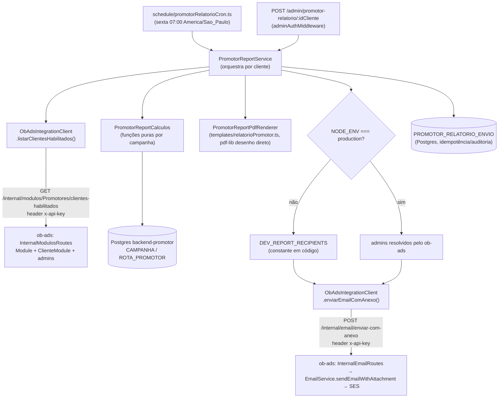
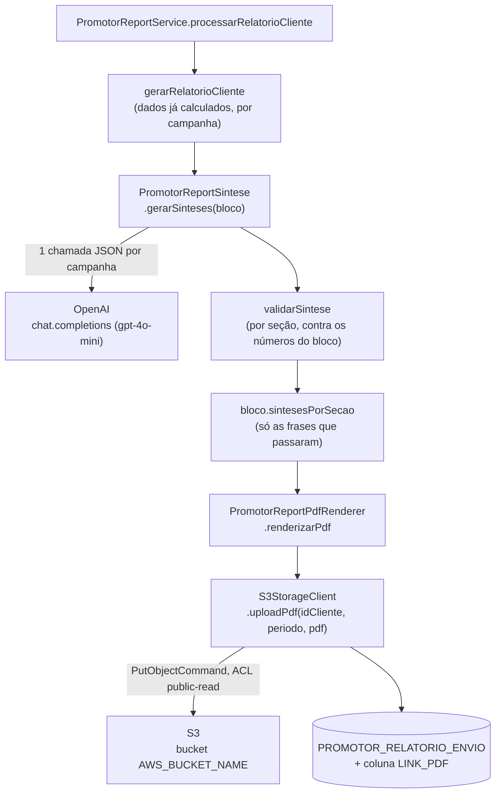

# Relatório Semanal de Promotores Design

**Spec**: `.specs/features/relatorio-semanal-promotores/spec.md`
**Status**: Done — Verifier PASS (Phases 1-5), + Phase 6 (AD-006/SKF-only) e Phase 7 (pdf-lib + gráfico por dia, pós-Execute, `tasks.md`)

**Escopo cross-repo**: esta feature toca dois repositórios com deploy independente — `backend-promotor` (todo o cálculo, PDF, cron, endpoint manual) e `backend-ob-ads` (2 endpoints internos novos, genéricos, reaproveitando `EmailService` e `Module/ClienteModule` já existentes). A fase Tasks deve sequenciar isso: endpoints do ob-ads primeiro, backend-promotor depois (ver Risco 4).

---

## Architecture Overview

O backend-promotor é o dono de todo o cálculo (dados vivem no Postgres dele) e da renderização do PDF. O backend-ob-ads é só "serviço de infraestrutura" pra duas coisas que já tem prontas e o backend-promotor não tem: saber quem é admin de um cliente, e mandar e-mail via SES. A guarda dev/produção (RELPROM-28 a 31) vive inteiramente no backend-promotor — o ob-ads nunca decide "pra quem" mandar, só manda pra lista que recebe.



---

## Code Reuse Analysis

### Existing Components to Leverage

| Component | Location | How to Use |
| --- | --- | --- |
| `listarCampanhasAtivas` (critério de campanha ativa) | `service/adminDisparoService.ts:178-208` | Reaproveitar a mesma condição (`STATUS='PUBLICADA' AND DELETED_AT IS NULL AND START_TIME<=agora AND (END_TIME IS NULL OR END_TIME>=agora)`) em vez de inventar um critério novo |
| `adminAuthMiddleware` | `middlewares/adminAuthMiddleware.ts` | Protege o novo endpoint manual, conforme AD-004 |
| `createDocumentedRoute` + padrão `router.use(adminAuthMiddleware)` + `responder()` | `routes/AdminDisparoRoute.ts:18-46` | Modelo exato pra declarar a rota nova, validar com zod e envelopar erro/sucesso |
| `node-cron` + guarda `NODE_ENV==="test"` + flag `*_ENABLED==="1"` + lock de sobreposição | `schedule/outboxNotificacaoCron.ts:30-32,48-84`, registrado em `app.ts:53` | Modelo exato pro cron novo (`PROMOTOR_RELATORIO_ENABLED`) |
| `AppDataSourceSync` / `data-source.ts` | `data-source.ts` | Acesso ao Postgres pra `ROTA_PROMOTOR`/`CAMPANHA`/`CAMPANHA_PROMOTOR` |
| `pdf-lib` (dependência já presente, não precisa de instalação nova) | — | **Pós-Execute**: substitui Playwright — desenho direto de PDF (texto/retângulo/linha), sem navegador/binário externo, sem risco de ambiente na EC2 de produção |
| `openai` (dependência já presente, `^5.20.3`, nunca integrada — `.specs/codebase/CONCERNS.md`) | — | **Pós-Execute (P7)**: primeiro uso real no repo — gera a síntese por seção via `chat.completions` |
| `@aws-sdk/client-s3` (dependência já presente, `^3.864.0`, nunca integrada — `.specs/codebase/CONCERNS.md`) | — | **Pós-Execute (P6)**: primeiro uso real no repo — upload do PDF gerado |
| `EmailService.sendEmailWithAttachment` | `backend-ob-ads/src/appplication/services/EmailService.ts:115-153` | Reaproveitado via novo endpoint interno fino, não reimplementado |
| Padrão de guarda de rota interna (`apiKeyGuard`, header `x-api-key`) | `backend-ob-ads/src/main/config/routes/CommunityReportInternalRoutes.ts:9-19` | Modelo exato de auth pros 2 endpoints internos novos |
| Query de resolução de `Usuario` por `idCliente` (M:N `USUARIO_X_CLIENTES` + direto) | `backend-ob-ads/src/appplication/services/communityReport/CommunityReportEmailService.ts:221-233` | Extrair pra uma função reaproveitável, invertendo `IS_ADMIN` (`=1` em vez de `IS NULL OR =0`), mantendo a exclusão de `@oficinabrasil.com.br` |
| Padrão de leitura de env "a cada chamada" (não cachear em const de módulo) | `CommunityReportEmailService.ts:62-70,86-88` | Mesmo cuidado pro `DEV_REPORT_RECIPIENTS`/checagem de `NODE_ENV`, por causa de `dotenv.config()` tardio |
| `Module` / `ClienteModule` | `backend-ob-ads/src/domain/entities/{Module,ClienteModule}.ts` | Existência de linha em `cliente_module` apontando pro módulo = "habilitado"; sem coluna de enabled |

### Integration Points

| Sistema | Método de integração |
| --- | --- |
| backend-ob-ads (SQL Server: `Module`, `ClienteModule`, `Usuario`) | `GET /internal/modulos/:nomeModulo/clientes-habilitados` (novo) |
| backend-ob-ads (SES via `EmailService`) | `POST /internal/email/enviar-com-anexo` (novo) |
| Postgres do backend-promotor (`CAMPANHA`, `CAMPANHA_PROMOTOR`, `ROTA_PROMOTOR`) | TypeORM, mesmas entities já existentes |
| Postgres do backend-promotor (auditoria/idempotência) | Nova tabela `PROMOTOR_RELATORIO_ENVIO` (migration manual, script `.sql`) |

---

## Components

### PromotorReportService
- **Purpose**: Orquestra a geração do relatório de um cliente — busca campanhas ativas, delega cálculo por campanha, monta o payload final, decide destinatários (guarda dev/prod) e dispara PDF + e-mail.
- **Location**: `service/promotorReportService.ts`
- **Interfaces**:
  - `gerarRelatorioCliente(idCliente: number, periodo: PeriodoRelatorio, opcoes?: { enviarEmail?: boolean }): Promise<ResultadoRelatorioCliente>` — usado tanto pelo cron quanto pelo endpoint manual
  - `processarClientesElegiveis(periodo: PeriodoRelatorio): Promise<ResumoExecucao>` — **pós-Execute (AD-006)**: itera `CLIENTES_PRODUCAO_HABILITADOS` (allowlist fixa, hoje só SKF) chamando `ObAdsIntegrationClient.resolverAdminsDoCliente` por cliente, em vez de `listarClientesHabilitados`. Trocar de volta é 1 linha, quando a migração acabar
- **Dependencies**: `ObAdsIntegrationClient`, `PromotorReportCalculos`, `PromotorReportPdfRenderer`, `AppDataSourceSync`, `PromotorRelatorioEnvioRepository`, `CLIENTES_PRODUCAO_HABILITADOS` (config novo)
- **Reuses**: `listarCampanhasAtivas` (adaptado de `adminDisparoService.ts:178-208`)

### config/promotorReportClientesProducao.ts (novo, pós-Execute — AD-006)
- **Purpose**: Allowlist fixa dos clientes que recebem o relatório em produção, enquanto o SQL Server estiver em congelamento (AD-006). Mesmo espírito de `DEV_REPORT_RECIPIENTS` (T14): hardcoded em código, não em tabela/env, documentado como temporário.
- **Location**: `config/promotorReportClientesProducao.ts`
- **Interfaces**: `CLIENTES_PRODUCAO_HABILITADOS: number[]` = `[126]` (SKF)
- **Dependencies**: nenhuma
- **Reuses**: nenhum — constante nova

### PromotorReportCalculos
- **Purpose**: Funções puras de cálculo por campanha (contagens, assertividade, agrupamento de destaques, contadores de próximos passos) — testáveis sem banco, seguindo a convenção do repo de isolar política de domínio em funções puras.
- **Location**: `utils/promotorReportCalculos.ts`
- **Interfaces**:
  - `calcularVisaoGeral(rotas: RotaPromotorRow[], periodo: PeriodoRelatorio): VisaoGeralCampanha`
  - `calcularAssertividade(concluidas: number, canceladas: number): number | "N/A"`
  - `agruparPorPromotor(rotas: RotaPromotorRow[], periodo: PeriodoRelatorio): LinhaPromotor[]`
  - `listarCancelamentos(rotas: RotaPromotorRow[], periodo: PeriodoRelatorio): Cancelamento[]` (RELPROM-08, corrigido durante T11 — faltava na listagem original)
  - `listarDestaquesDeCampo(rotas: RotaPromotorRow[], periodo: PeriodoRelatorio): DestaqueCampo[]`
  - `calcularProximosPassos(visaoGeral: VisaoGeralCampanha, porPromotor: LinhaPromotor[]): ProximosPassos` (reaproveita os cálculos já feitos em vez de reprocessar `rotas`)
- **Dependencies**: nenhuma (puro)
- **Reuses**: nada — é a lógica de domínio nova desta feature

### PromotorReportPdfRenderer
- **Purpose**: Gera o PDF do relatório (capa + blocos por campanha).
- **Location**: `service/promotorReportPdfRenderer.ts` — wrapper fino que só chama `construirPdf` e converte `Uint8Array` pra `Buffer`; toda a lógica de desenho mora em `templates/relatorioPromotor.ts`
- **Interfaces**:
  - `renderizarPdf(dados: RelatorioPromotorData): Promise<Buffer>` (contrato inalterado — `PromotorReportService` não precisou mudar)
  - `construirPdf(dados: RelatorioPromotorData): Promise<Uint8Array>` (em `templates/relatorioPromotor.ts`)
- **Dependencies**: `pdf-lib` (`PDFDocument`, fontes padrão `StandardFonts.Helvetica`/`HelveticaBold` — sem fonte customizada embutida, exigiria a dependência separada `@pdf-lib/fontkit`, não presente no projeto)
- **Reuses**: nada de `assets/fonts`/`assets/img/obLogo.png`/`assets/pdf/capaOb.pdf` — identidade visual replicada via paleta de cores (constantes `COR_*`) desenhada direto com `pdf-lib`, não via asset de arquivo
- **Pós-Execute (motivo da troca)**: Playwright exigia Chromium instalado no SO de produção (EC2 Amazon Linux 2023, sem Docker) — risco validado e mitigável (T01), mas ainda assim uma dependência de ambiente frágil pra um cron de produção. Trocado por `pdf-lib`: desenho direto do PDF (texto, retângulo, linha), zero dependência de binário/navegador externo. Página no formato slide widescreen (960x540pt, não A4) e paleta navy/verde-limão/menta, pra reproduzir a mesma organização e proporção do modelo do CON26-325 (feedback do usuário após a 1ª versão). Ver Phase 7 em `tasks.md` e AD-007 em `STATE.md`.

### ObAdsIntegrationClient
- **Purpose**: Cliente HTTP fino pros endpoints internos do ob-ads. Isola toda a integração cross-service num único arquivo, com timeout e tratamento de erro padronizado.
- **Location**: `service/obAdsIntegrationClient.ts`
- **Interfaces**:
  - `listarClientesHabilitados(nomeModulo: string, idCliente?: number): Promise<ResultadoListagem>` — caminho baseado em módulo (T03/T05), dormente em produção (AD-006), mantido pra pós-migração
  - `resolverAdminsDoCliente(idCliente: number): Promise<ResultadoResolucaoCliente>` — **novo, pós-Execute**: chama `GET /internal/clientes/:idCliente/admins` (`InternalClientesRoutes`), sem passar por módulo. Caminho ativo em produção enquanto AD-006 estiver em vigor (RELPROM-42)
  - `enviarEmailComAnexo(req: EnviarEmailComAnexoRequest): Promise<{ sucesso: true } | { sucesso: false; motivo: string }>`
- **Dependencies**: `OBADS_BASE_URL`, `INTERNAL_API_KEY` (env novas), `fetch` nativo do Node 20 (sem nova dependência)
- **Reuses**: nenhum código, mas espelha o padrão de erro-como-união (nunca lança, retorna `{sucesso, motivo?}`) já usado em `ChannelSendResult`/`rotaService.notificarRotasCriadas`

### PromotorReportRoute / promotorReportController
- **Purpose**: Endpoint administrativo de disparo manual.
- **Location**: `routes/PromotorRelatorioRoute.ts`, `controllers/promotorReportController.ts`
- **Interfaces**:
  - `POST /admin/promotor-relatorio/:idCliente/gerar` — query opcional `inicio`, `fim` (ISO date), `enviarEmail` (boolean, default `true`); resposta: PDF binário (`Content-Type: application/pdf`) quando sucesso, ou JSON `{message, error}` quando falha (cliente sem módulo/sem campanha/não encontrado → 404; demais erros → 500), seguindo o mesmo envelope de erro do resto do repo.
- **Dependencies**: `adminAuthMiddleware`, `PromotorReportService`
- **Reuses**: `createDocumentedRoute`, padrão `responder()` de `routes/AdminDisparoRoute.ts`

### schedule/promotorRelatorioCron.ts
- **Purpose**: Dispara `PromotorReportService.processarClientesElegiveis` toda sexta-feira.
- **Location**: `schedule/promotorRelatorioCron.ts`, registrado em `app.ts` (mesmo ponto de `outboxNotificacaoCron`, dentro do `.then()` do `AppDataSourceSync.initialize()`)
- **Interfaces**: `registrarPromotorRelatorioCron(): void`
- **Dependencies**: `node-cron`, env `PROMOTOR_RELATORIO_ENABLED`
- **Reuses**: estrutura 1:1 de `schedule/outboxNotificacaoCron.ts` (guarda `NODE_ENV==="test"`, flag `"1"`, lock de sobreposição)

### PromotorRelatorioEnvioRepository (+ entity)
- **Purpose**: Registrar cada geração/envio (sucesso ou falha) pra idempotência do cron e auditoria de ambos os gatilhos.
- **Location**: `entities/PromotorRelatorioEnvio.ts`, leitura/escrita direto via `AppDataSourceSync.getRepository()` dentro de `PromotorReportService` (sem repositório próprio adicional — convenção do repo não usa camada repository separada)
- **Reuses**: convenção de entity TypeORM já usada em `entities/*.ts`

---

### backend-ob-ads — novos componentes (repo irmão)

### InternalModulosRoutes
- **Purpose**: Expõe "quais clientes têm o módulo X habilitado, e quem são os admins deles".
- **Location**: `backend-ob-ads/src/main/config/routes/InternalModulosRoutes.ts` (novo arquivo)
- **Interfaces**: `GET /internal/modulos/:nomeModulo/clientes-habilitados?idCliente=<opcional>` → `{ idCliente, nomeCliente, admins: string[] }[]`
- **Dependencies**: `apiKeyGuard` (novo, reaproveitando o padrão de `CommunityReportInternalRoutes.ts:9-19`, env `INTERNAL_API_KEY`), `Module`, `ClienteModule`, `Usuario`, `USUARIO_X_CLIENTES`
- **Reuses**: query de `CommunityReportEmailService.ts:221-233`, invertendo `IS_ADMIN`

### InternalEmailRoutes
- **Purpose**: Wrapper fino e genérico sobre `EmailService.sendEmailWithAttachment`, reaproveitável por qualquer feature interna futura (não só promotores).
- **Location**: `backend-ob-ads/src/main/config/routes/InternalEmailRoutes.ts` (novo arquivo)
- **Interfaces**: `POST /internal/email/enviar-com-anexo` body `{ to: string[], subject: string, bodyHtml: string, attachment: { filename: string, contentBase64: string, contentType: string } }` → `{ success: boolean, error?: string }`
- **Dependencies**: `apiKeyGuard`, `EmailService`
- **Reuses**: `EmailService.sendEmailWithAttachment` (`EmailService.ts:115-153`) sem alteração

### InternalClientesRoutes (novo, pós-Execute — AD-006)
- **Purpose**: Resolve admins de **1 cliente explícito por `ID_CLIENTE`**, sem passar por `module`/`cliente_module` — caminho usado enquanto o SQL Server estiver em congelamento pré-migração (AD-006) e só a SKF for allowlisted (RELPROM-40 a 43). `InternalModulosRoutes` continua existindo, intocada, pra quando a migração acabar.
- **Location**: `backend-ob-ads/src/main/config/routes/InternalClientesRoutes.ts` + `src/presentation/controllers/InternalClientesController.ts` (novos)
- **Interfaces**: `GET /internal/clientes/:idCliente/admins` → `{ idCliente, nomeCliente, admins: string[] }`, 404 se `Cliente` não existir
- **Dependencies**: `apiKeyGuard` (T02, reaproveitado), `Cliente`, `AdminResolverService` (T04, reaproveitado sem alteração)
- **Reuses**: `AdminResolverService.resolverAdminsPorCliente` (já existe, T04) — este componente só soma a consulta de `Cliente` por `ID_CLIENTE` e empacota a resposta; nenhuma lógica de admin nova

---

## Data Models

```typescript
interface PeriodoRelatorio {
  inicio: Date // corte inclusivo
  fim: Date    // corte inclusivo, 23:59:59 America/Sao_Paulo
}

interface ClienteModuloHabilitado {
  idCliente: number
  nomeCliente: string
  admins: string[] // e-mails reais; backend-promotor decide se usa ou troca pela DEV_REPORT_RECIPIENTS
}

type SecaoRelatorio = "visaoGeral" | "assertividade" | "porPromotor" | "cancelamentos" | "destaques" | "proximosPassos"
type SintesesPorSecao = Partial<Record<SecaoRelatorio, string>> // RELPROM-49/50/51, pós-Execute — só as seções com frase validada aparecem aqui

interface CampanhaBlocoRelatorio {
  idCampanha: number
  nomeCampanha: string
  visaoGeral: { concluidas: number; canceladas: number; abertasNaRota: number } // sem "promotoresComRegistro": nenhuma AC da spec pede esse resumo, a tabela por promotor (RELPROM-07) já cobre a informação — corrigido durante T10
  visitasPorDia: { dia: string; concluidas: number; canceladas: number }[] // RELPROM-44, pós-Execute — dd/MM America/Sao_Paulo, só dias com atividade (sem barra zerada)
  assertividade: number | "N/A"
  porPromotor: LinhaPromotor[]
  cancelamentos: { promotor: string; oficina: string; cidade: string; obs: string | null }[]
  destaquesDeCampo: { status: "concluida" | "cancelada"; promotor: string; oficina: string; obs: string }[]
  proximosPassos: { abertasNaRota: number; canceladasARedistribuir: number; promotoresSemRegistro: number }
  sintesesPorSecao?: SintesesPorSecao // RELPROM-49, pós-Execute — opcional: ausente/parcial quando a IA falhar ou alguma frase for descartada
}

interface RelatorioPromotorData {
  idCliente: number
  nomeCliente: string
  periodo: PeriodoRelatorio
  campanhas: CampanhaBlocoRelatorio[] // 1 bloco por campanha ativa (RELPROM-26/27)
}

interface EnviarEmailComAnexoRequest {
  to: string[]
  subject: string
  bodyHtml: string
  attachment: { filename: string; contentBase64: string; contentType: "application/pdf" }
}
```

**Relationships**: `RelatorioPromotorData` é 1:N com `CampanhaBlocoRelatorio` (RELPROM-26). `ClienteModuloHabilitado` vem do ob-ads e alimenta tanto a lista de clientes elegíveis (cron) quanto a validação do endpoint manual (RELPROM-39).

### PromotorRelatorioEnvio (entity nova, Postgres — `CAMPANHAS_OB.PROMOTOR_RELATORIO_ENVIO`)

```typescript
interface PromotorRelatorioEnvio {
  ID: number // PK serial
  ID_CLIENTE: number
  PERIODO_INICIO: Date
  PERIODO_FIM: Date
  ORIGEM: "CRON" | "MANUAL" // manual nunca bloqueia idempotência do cron
  STATUS: "SUCESSO" | "FALHA"
  MOTIVO_FALHA: string | null
  DESTINATARIOS: string[] // jsonb — o que foi efetivamente usado (lista dev ou admins reais)
  AMBIENTE: "production" | "nao-production"
  CRIADO_EM: Date
  LINK_PDF: string | null // RELPROM-45, pós-Execute — URL pública do PDF no S3; null quando enviarEmail=false ou o upload falhou
}
```

**Relationships**: chave única `(ID_CLIENTE, PERIODO_INICIO, PERIODO_FIM, ORIGEM)` só quando `ORIGEM='CRON'` e `STATUS='SUCESSO'` — é essa combinação que a RELPROM-18 proíbe duplicar. `ORIGEM='MANUAL'` não entra nessa restrição (testes podem repetir à vontade).

---

## Error Handling Strategy

| Error Scenario | Handling | User Impact |
| --- | --- | --- |
| ob-ads indisponível/timeout ao **listar clientes elegíveis** (chamada única por execução do cron) | Aborta a execução inteira dessa semana, loga erro único, resumo final reporta "0 processados, falha ao listar clientes elegíveis" | Nenhum cliente recebe relatório nessa semana; corrigido na próxima execução |
| ob-ads indisponível/timeout ao **enviar e-mail de um cliente específico** | Isola — grava `STATUS='FALHA'` em `PROMOTOR_RELATORIO_ENVIO`, loga com `[relatorioPromotores]` + idCliente, segue pro próximo cliente (RELPROM-17) | Aquele cliente não recebe nessa semana; os demais recebem normalmente |
| Falha ao renderizar PDF (`pdf-lib`) de um cliente | Mesmo tratamento do item acima — isolado por cliente | Idem |
| `INTERNAL_API_KEY` ausente/errada (401 do ob-ads) | Erro de configuração, não de dado — aborta a execução inteira (não adianta tentar o próximo cliente, vai falhar igual); loga como erro crítico de config | Nenhum cliente recebe até a config ser corrigida |
| Cliente sem nenhum admin resolvido (produção) | RELPROM-12 — loga falha de destinatário, não envia, segue pros demais | Aquele cliente não recebe |
| Lista `DEV_REPORT_RECIPIENTS` vazia fora de produção | RELPROM-30 — não envia, loga condição | Nenhum e-mail sai em dev até a lista ser preenchida no código |
| Endpoint manual chamado pra cliente sem módulo/campanha | RELPROM-39 — 404 com mensagem identificando a condição que falhou | Quem chamou o endpoint vê o motivo exato na resposta |
| PDF gerado maior que ~5MB | Loga aviso (margem de segurança abaixo do limite prático do SES de ~10MB por mensagem); não bloqueia o envio no MVP | Nenhum, é só um alerta operacional |

---

## Risks & Concerns

| Concern | Location (file:line) | Impact | Mitigation |
| --- | --- | --- | --- |
| ~~Playwright/Chromium em produção~~ — **Removido pós-Execute (AD-007)**: T01 validou que dava pra rodar na EC2 (Amazon Linux 2023, sem Docker) via `dnf install` manual de ~20 pacotes de sistema, mas era um risco residual permanente (reprovisionar a instância exige repetir o passo manual; SO não oficialmente suportado pelo Playwright). Trocado por `pdf-lib` (desenho direto, zero dependência de SO/navegador) — ver AD-007 em `STATE.md`, Phase 7 em `tasks.md`. `playwright` removido do `package.json`, `scripts/spike-playwright-ec2.ts` apagado | — (dependência não existe mais) | — (risco eliminado, não só mitigado) | N/A — não se aplica mais |
| Schema real de `ROTA_PROMOTOR.STATUS` / colunas de `CAMPANHA` não confirmado por `SELECT` ao vivo nesta sessão (`.env.readonly` ausente nesta máquina) | `scripts/db-query.ts` (bloqueado), compensado por `service/adminDisparoService.ts:178-208` (fonte de verdade via código) | Cálculos podem divergir do schema real se o enum tiver mudado desde a última leitura das entities | Antes de implementar `PromotorReportCalculos`, configurar `.env.readonly` e rodar `db-query.ts` pra confirmar os valores distintos reais de `STATUS` e as colunas de `CAMPANHA` |
| `GET /internal/modulos/:nomeModulo/clientes-habilitados` não tem nenhum precedente no ob-ads — é lógica 100% nova (SQL Server) | `backend-ob-ads/src/domain/entities/{Module,ClienteModule}.ts` | Maior risco de bug em código sem padrão testado pra copiar | Cobertura de teste de integração dedicada no Tasks (reaproveitando o padrão de teste já usado pra `CommunityReportEmailService`) |
| `POST /internal/email/enviar-com-anexo` é um endpoint genérico e poderoso (manda e-mail arbitrário pra qualquer destinatário, dado o anexo) | `backend-ob-ads/src/main/config/routes/InternalEmailRoutes.ts` (novo) | Se `INTERNAL_API_KEY` vazar, qualquer chamador pode mandar e-mail arbitrário via o SES de produção | Mesma postura de `CommunityReportInternalRoutes` (sem exposição pública, só rede interna); logar remetente/feature de origem em todo envio pra rastreabilidade; chave rotacionável via env sem deploy de código |
| Nenhum precedente de resposta binária (PDF) em nenhum controller do backend-promotor | `controllers/*.ts` (nenhum usa `res.send(Buffer)`/`application/pdf`) | Primeiro caso — maior chance de erro de `Content-Type`/`Content-Disposition` não percebido em teste unitário | Teste de integração específico verificando `Content-Type: application/pdf` e que o corpo é um PDF válido (ex. começa com `%PDF-`) |
| Deploy cross-repo: backend-promotor chamando endpoints que ainda não existem no ob-ads | — | Cron/endpoint manual falha 100% se subir fora de ordem | Sequenciar Tasks: endpoints do ob-ads primeiro (deploy + validação), backend-promotor depois; tratar 404 do ob-ads como falha de config (mesmo tratamento de `INTERNAL_API_KEY` errada) |

---

## Tech Decisions (only non-obvious ones)

| Decision | Choice | Rationale |
| --- | --- | --- |
| Mecanismo de acoplamento cross-service | 2 endpoints internos **genéricos** no ob-ads (`clientes-habilitados` por módulo, `enviar-com-anexo`), autenticados por API key compartilhada, guarda dev/prod só no backend-promotor | Confirmado com o usuário; reaproveita SES/SQL Server já existentes e prontos; evita duplicar credenciais/lógica de "quem é admin" em dois lugares |
| Nome do secret de API key interna | `INTERNAL_API_KEY` único, compartilhado por endpoints internos genéricos (não um por feature) | Os 2 endpoints novos não são específicos de "promotor" — uma chave por feature (como `COMMUNITY_REPORT_INTERNAL_API_KEY`) criaria uma chave nova a cada endpoint genérico futuro, sem ganho de segurança real (mesmo chamador: backend-promotor) |
| Renderização de PDF | ~~Playwright (HTML → PDF)~~ **Pós-Execute: `pdf-lib` (desenho direto)** | Decisão original (Playwright) assumia que `pdf-lib` não suportava layout com cards/tabela — na prática, deu pra reproduzir com funções de desenho manual (cursor + paginação própria); eliminou o risco de dependência de SO/navegador em produção (EC2 sem Docker). Ver AD-007 em `STATE.md` |
| Formato de página do PDF | Slide widescreen 960x540pt (não A4) | Pós-Execute, feedback do usuário: o modelo do CON26-325 é um deck, não um documento — A4 retrato deixava excesso de espaço em branco em todo conteúdo que não preenche a página inteira |
| Gráfico de visitas por dia (RELPROM-44) | Barras pareadas (concluídas/canceladas) por dia, navy/vermelho, só dias com atividade | Reproduz o gráfico existente no modelo do CON26-325 que faltava na 1ª versão do PDF gerado; cor vermelha (não a menta usada em outros cards) porque menta tem contraste baixo demais contra fundo branco pra ser legível num gráfico |
| Idempotência do cron | Tabela nova `PROMOTOR_RELATORIO_ENVIO` com chave única `(ID_CLIENTE, PERIODO_INICIO, PERIODO_FIM, ORIGEM='CRON', STATUS='SUCESSO')` | Resposta determinística sem depender de estado externo; `ORIGEM='MANUAL'` fica isenta, então o endpoint de teste nunca é bloqueado |
| Definição de "campanha ativa" | `STATUS='PUBLICADA' AND DELETED_AT IS NULL AND START_TIME<=agora AND (END_TIME IS NULL OR END_TIME>=agora)` | Mesma regra já usada em produção por `adminDisparoService.listarCampanhasAtivas` — reaproveitar em vez de inventar critério novo |
| Identificador de cliente usado nas rotas/integração | `ID_CLIENTE` (o mesmo `Campanha.ID_CLIENT`, direto o ID do SQL Server — `entities/Campanha.ts:40`) | Diferente do `CommunityReport` (que precisa de `ClientClientTraining` pra traduzir Postgres↔SQL Server), aqui `Campanha.ID_CLIENT` já é o ID do SQL Server — nenhuma tabela de tradução necessária |
| **Pós-Execute**: elegibilidade de cliente em produção | Allowlist fixa em código (`CLIENTES_PRODUCAO_HABILITADOS = [126]`) + endpoint novo não-gated-por-módulo (`/internal/clientes/:idCliente/admins`), em vez do fluxo `module`/`cliente_module` (T03/T05) | AD-006: SQL Server em congelamento pré-migração pra Postgres, DBA pediu pra não acrescentar nada lá. T07 (INSERT do módulo) nunca roda enquanto isso vigorar. Código do módulo fica pronto/testado, só não é o caminho ativo |

> **Project-level decisions**: a decisão sobre congelamento do SQL Server pré-migração está registrada como `AD-006` em `.specs/STATE.md` — vale pra qualquer feature futura que cogitasse escrever lá, não só esta.
>
> As decisões abaixo (`INTERNAL_API_KEY` compartilhado, endpoints genéricos) continuam valendo: a decisão de secret compartilhado (`INTERNAL_API_KEY`) e o padrão de endpoints internos genéricos (em vez de um por feature) são convenção pra qualquer integração cross-service futura entre backend-promotor e backend-ob-ads — registrada como `AD-005` em `.specs/STATE.md`.

---

## P6/P7 — Arquivamento no S3 + Síntese por IA (RELPROM-45 a 52, Design pós-Execute)

Cobre só o que o `context.md` de 2026-10-30 trouxe de novo. Nem S3 nem nenhum provedor de IA têm uso hoje neste repo — `@aws-sdk/client-s3` (`^3.864.0`) e `openai` (`^5.20.3`) já estão no `package.json` (declaradas, nunca integradas, ver `.specs/codebase/CONCERNS.md`), então não entra dependência nova, só uso real da que já existe.

### Architecture Overview (adendo)



Falha em `SINTESE` ou em `S3CLIENTE` nunca interrompe o fluxo — cada um devolve `{}`/`null` em vez de lançar, e `processarRelatorioCliente` segue com o que conseguiu (RELPROM-46, RELPROM-51).

### Componentes novos

#### PromotorReportSintese
- **Purpose**: Gera 1 frase curta de síntese por seção (6 por bloco de campanha), a partir só dos dados já calculados — nunca pede à IA pra calcular nada.
- **Location**: `service/promotorReportSintese.ts` (novo)
- **Interfaces**:
  - `gerarSinteses(bloco: CampanhaBlocoRelatorio): Promise<SintesesPorSecao>` — nunca lança; retorna `{}` se a chamada à OpenAI falhar inteira, ou um objeto parcial se só algumas seções passaram na validação
- **Dependencies**: `openai` (`OpenAI.chat.completions.create`, `response_format: {type: "json_object"}`), env `OPENAI_API_KEY` (nova)
- **Reuses**: padrão de erro-como-união já usado em `ObAdsIntegrationClient`/`rotaService.notificarRotasCriadas` (nunca lança, degrada em vez de propagar)

#### validarSintese (guardrail anti-alucinação)
- **Purpose**: Função pura — extrai todo número presente numa frase candidata e confere contra o conjunto de números válidos daquela seção (vindos dos dados já calculados); descarta a frase se achar um número que não bate.
- **Location**: `utils/promotorReportSinteseValidacao.ts` (novo — função pura, testável isolada sem mockar OpenAI, mesmo padrão de `utils/promotorReportCalculos.ts`)
- **Interfaces**:
  - `extrairNumeros(texto: string): number[]`
  - `validarSintese(texto: string, numerosValidos: number[]): boolean`
  - `numerosValidosDaSecao(secao: SecaoRelatorio, bloco: CampanhaBlocoRelatorio): number[]` — monta o conjunto de números "permitidos" daquela seção (ex.: visão geral → `{concluidas, canceladas, abertasNaRota}`; assertividade → `{assertividade, concluidas, canceladas, concluidas+canceladas}`; por promotor → todos os 4 contadores de cada linha + totais; cancelamentos → `{cancelamentos.length}`; destaques → `{qtdConcluidasComObs, qtdCanceladasComObs}`; próximos passos → `{abertasNaRota, canceladasARedistribuir, promotoresSemRegistro}`)
- **Dependencies**: nenhuma (puro)
- **Reuses**: nada — lógica nova desta adição

#### S3StorageClient
- **Purpose**: Sobe o PDF gerado pro S3 e devolve a URL pública do objeto.
- **Location**: `service/s3StorageClient.ts` (novo)
- **Interfaces**:
  - `uploadPdf(params: { idCliente: number; periodo: PeriodoRelatorio; pdf: Buffer }): Promise<{ sucesso: true; url: string } | { sucesso: false; motivo: string }>` — nunca lança
- **Dependencies**: `@aws-sdk/client-s3` (`S3Client`, `PutObjectCommand`), envs já declaradas `AWS_REGION`, `AWS_BUCKET_NAME`, `AWS_ACCESS_KEY_ID`, `AWS_SECRET_ACCESS_KEY`
- **Reuses**: mesmo padrão de erro-como-união dos demais clients externos desta feature

### Mudanças em componentes existentes

| Componente | Mudança |
| --- | --- |
| `types/promotorRelatorio.ts` | `CampanhaBlocoRelatorio` ganha `sintesesPorSecao?: SintesesPorSecao` (novo tipo `SecaoRelatorio` = `"visaoGeral" \| "assertividade" \| "porPromotor" \| "cancelamentos" \| "destaques" \| "proximosPassos"`, `SintesesPorSecao = Partial<Record<SecaoRelatorio, string>>`) |
| `service/promotorReportService.ts` | `processarRelatorioCliente`: depois de `gerarRelatorioCliente` e antes de `renderizarPdf`, chama `PromotorReportSintese.gerarSinteses` por campanha e anexa o resultado ao bloco; depois de `renderizarPdf` (só quando `enviarEmail=true`), chama `S3StorageClient.uploadPdf` e passa `linkPdf` pra `registrarAuditoria` |
| `templates/relatorioPromotor.ts` | Cada `desenharXxx` de seção (visão geral, assertividade, por promotor, cancelamentos, destaques, próximos passos) desenha `bloco.sintesesPorSecao?.[secao]` logo após `desenharLinhaDestaque`, reaproveitando o estilo já existente de `desenharCallout` — se a chave não existir (seção sem síntese), não desenha nada, sem buraco em branco |
| `entities/PromotorRelatorioEnvio.ts` | Nova coluna `LINK_PDF?: string \| null` (`TEXT`, nullable) |
| `scripts/migration-promotor-relatorio-envio-link-pdf.sql` (novo) | `ALTER TABLE ... ADD COLUMN IF NOT EXISTS "LINK_PDF" TEXT` — execução manual, mesma convenção dos demais scripts desta feature |

### Error Handling Strategy (adendo)

| Error Scenario | Handling | User Impact |
| --- | --- | --- |
| Chamada à OpenAI falha (timeout/erro/resposta vazia/JSON inválido) | `gerarSinteses` devolve `{}`, loga o erro; PDF segue sem nenhuma frase de síntese | Relatório sai normal, só sem as frases curtas |
| Frase de 1 seção cita número fora dos dados calculados | `validarSintese` descarta só aquela frase; as demais seções (se válidas) continuam com a delas | Seção específica aparece sem a frase; resto do PDF não é afetado |
| Upload pro S3 falha (credencial, bucket, rede) | `S3StorageClient.uploadPdf` devolve `{sucesso:false}`; `registrarAuditoria` grava `LINK_PDF=null`, loga o erro | E-mail sai normal, igual hoje; só o link de arquivamento fica ausente pra aquele envio |
| `OPENAI_API_KEY` ausente | Mesmo tratamento de chamada-falhou — `gerarSinteses` trata erro de autenticação como qualquer outra falha da chamada, devolve `{}` | PDF sai sem nenhuma frase até a chave ser configurada |

### Risks & Concerns (adendo)

| Concern | Location (file:line) | Impact | Mitigation |
| --- | --- | --- | --- |
| Bucket pode ter "Block Public Access"/ACLs desabilitadas (padrão da AWS desde 2021) — `ACL: "public-read"` por objeto falharia ou seria ignorado nesse caso | `service/s3StorageClient.ts` (novo) | Upload pode falhar 100% das vezes mesmo com credencial válida, até alguém ajustar a configuração do bucket (fora do código) | Tratado como falha isolada (não bloqueia o envio, RELPROM-46); task dedicada no Execute testa 1 upload real contra o bucket real antes de confiar no fluxo em produção — mesmo espírito do spike T01 do Playwright. Se ACL por objeto não for permitida, a alternativa é uma bucket policy pública no prefixo `promotor-relatorio/*` (mudança de infra, fora do código) |
| Chave S3 só com `idCliente` + período (`promotor-relatorio/{idCliente}/{periodoInicio}_{periodoFim}.pdf`) é adivinhável por qualquer um que saiba o `ID_CLIENTE` e tente datas — mesmo sendo "público", a única proteção real seria a URL ser imprevisível | `service/s3StorageClient.ts` (novo) | Enumeração de URLs de outros clientes/períodos sem credencial nenhuma | Acrescentado um sufixo aleatório (`crypto.randomUUID()`) na chave: `promotor-relatorio/{idCliente}/{periodoInicio}_{periodoFim}-{uuid}.pdf` — mantém público conforme decidido, mas deixa de ser trivialmente enumerável |
| Dados de negócio do cliente (nomes de promotor/oficina, texto livre de OBS) trafegam pra uma API de terceiro (OpenAI) | `service/promotorReportSintese.ts` (novo) | Exposição de dado de cliente a um provedor externo | Risco aceito implicitamente pelo pedido do usuário (P7); nenhuma anonimização pedida. Registrar aqui pra não ficar implícito — revisitar se algum cliente futuro tiver cláusula contratual contra isso |
| Custo/latência de IA cresce linearmente com o número de clientes elegíveis quando a migração SQL Server→Postgres acabar e o módulo "promotores" for religado (hoje só SKF) | `service/promotorReportSintese.ts` (novo) | Nenhum hoje (1 cliente só); vira custo real na escala do módulo | 1 chamada combinada por campanha (JSON com as 6 frases), não 6 chamadas separadas; modelo econômico (`gpt-4o-mini`) — reavaliar custo quando o módulo for religado |

### Tech Decisions (adendo)

| Decision | Choice | Rationale |
| --- | --- | --- |
| Granularidade das chamadas à OpenAI | 1 chamada por campanha, pedindo as 6 frases de uma vez (`response_format: json_object`), não 6 chamadas separadas | Reduz custo/latência/chance de rate-limit em 6x; a validação (`validarSintese`) continua por seção, então 1 frase ruim não derruba as outras 5 mesmo vindo da mesma chamada |
| Modelo da OpenAI | `gpt-4o-mini` | Tarefa é descrever em prosa números já prontos, não raciocínio complexo — modelo econômico é suficiente; documentado como decisão de Design (Agent's Discretion no `context.md`) |
| Chave do objeto no S3 | `promotor-relatorio/{idCliente}/{periodoInicio}_{periodoFim}-{uuid}.pdf` (sufixo aleatório) | Mantém a convenção legível (dá pra saber de qual cliente/período é só olhando o path) sem deixar a URL trivialmente adivinhável, dado que o objeto é público sem expiração (RELPROM-47) |
| Onde a síntese entra no PDF | Mesmo visual de `desenharCallout` (já existe), logo após a linha de destaque de cada seção | Reaproveita componente visual já testado em vez de criar um estilo novo só pra isso; mantém a distinção visual entre "texto gerado" e "dado determinístico" sutil mas presente |
