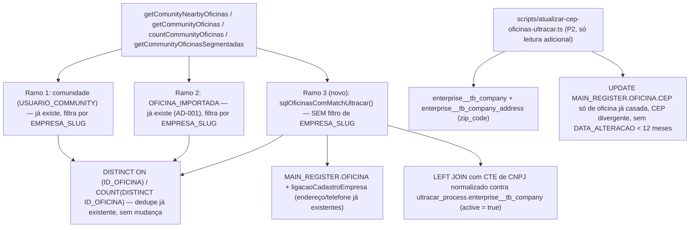

# Base de Oficinas da Ultracar nos Promotores Design

**Spec**: `.specs/features/ultracar-oficinas-promotores/spec.md`
**Status**: Draft

**Nota de revisão**: este design substitui a versão anterior depois que o usuário inverteu a regra de visibilidade (ver spec.md): só oficina **com** match de CNPJ passa a ter bypass de comunidade; oficina **sem** match não aparece em nada. Isso elimina quase toda a complexidade do design anterior — cache de endereço, geocodificação e id sintético deixaram de ser necessários, porque a oficina com match já é uma linha real de `MAIN_REGISTER.OFICINA` com endereço/telefone próprios. O que continua valendo da investigação anterior (medida em produção, só `SELECT`) está resumido abaixo; detalhe completo da investigação ficou no histórico de `design.md` (commit anterior) e em `.specs/STATE.md` (AD-010).

---

## O que a investigação anterior ainda entrega para este design

| Achado (medido, não presumido) | Uso neste design |
|---|---|
| `EXISTS`/`OR` correlacionado contra `dw.cadastro_empresa` estourou o timeout de 10s; reescrito como `LEFT JOIN` com CTE normalizada rodou em ~2s para a base Ultracar inteira (4.612 oficinas ativas) | É exatamente a forma de query que decide "tem match" aqui — ver Tech Decisions e AD-010 (`.specs/STATE.md`), ponto 2 |
| `enterprise__tb_company` (6.093 linhas) e `enterprise__tb_company_address` (6.103 linhas) são pequenas, com PK indexada | Seguro consultar ao vivo. `enterprise__tb_company` entra na query de match (este design); `enterprise__tb_company_address` só é usada pelo script de CEP (P2), não no caminho de leitura ao vivo |
| `st_obads_im` (12,69M linhas, sem índice em `cnpj`/`id_oficina`/`cep`) | **Não é mais necessária nesta spec.** Só servia para endereço/cidade de oficina sem match — que não aparece mais. AD-010 ponto 1 (nunca consultar ao vivo) continua válido como regra geral, só não é exercido por este design |
| Id da Ultracar colide com `ID_OFICINA` (faixas se sobrepõem) | **Não é mais necessário.** Oficina com match usa seu `ID_OFICINA` real — não existe mais id sintético a inventar. AD-010 ponto 3 fica como referência pra uma eventual feature futura, não usado aqui |
| Taxa de match real: 2.405 de 4.612 oficinas ativas da Ultracar (52%) já têm CNPJ na nossa base | É exatamente o universo que passa a ganhar bypass de comunidade — dimensiona o volume do novo ramo da `UNION` |

---

## Architecture Overview

Um terceiro ramo de `UNION ALL`, ao lado dos dois que já existem (comunidade via `USUARIO_COMMUNITY`, e `OFICINA_IMPORTADA` — AD-001), nos métodos de `OficinaService` que filtram por `EMPRESA_SLUG`. O ramo novo seleciona de `MAIN_REGISTER.OFICINA` (com o mesmo `ligacaoCadastroEmpresa` que os outros ramos já usam) — **sem** filtro de `EMPRESA_SLUG` — restrito a oficinas cujo CNPJ bate com uma linha ativa de `ultracar_process.enterprise__tb_company`. O `DISTINCT ON ("ID_OFICINA")`/`COUNT(DISTINCT "ID_OFICINA")` que cada método já usa para combinar os ramos faz a deduplicação de graça — nenhuma lógica nova de dedupe é necessária.

`ultracar_process.enterprise__tb_company_address` e `ultracar_process.st_obads_im` **não** entram no caminho de leitura ao vivo — a primeira só é lida pelo script de CEP (P2, fora do request path), a segunda não é usada em nenhum componente desta spec.

---

## Code Reuse Analysis

### Existing Components to Leverage

| Component | Location | How to Use |
|---|---|---|
| `cnpjIntDaOficina`, `cnpjIntParaLigacao`, `ligacaoCadastroEmpresa` | `utils/sqlCadastroEmpresa.ts` | Mesma convenção de normalização/ligação de CNPJ — a oficina com match usa exatamente o endereço/telefone que esse helper já resolve, sem nenhum dado novo |
| Os 2 ramos `UNION ALL` já existentes em `getComunityNearbyOficinas`/`getCommunityOficinas`/`countCommunityOficinas` | `service/oficinaService.ts` | Template literal do 3º ramo: mesmas colunas de saída. Como o 3º ramo lê só de `OFICINA`/`dw`, as colunas batem exatamente com o ramo 1 (comunidade), bastando reaproveitar a mesma projeção |
| `DISTINCT ON ("ID_OFICINA")` / `COUNT(DISTINCT "ID_OFICINA")` | `service/oficinaService.ts` (wrapper externo de cada método) | Dedupe entre os 3 ramos já é automático — oficina que está em comunidade E tem match Ultracar aparece uma vez só, sem código novo |
| `scripts/atualizar-lat-long-comunidade.ts` (esqueleto `--teste[=N]`) | `scripts/atualizar-lat-long-comunidade.ts` | Template de CLI para o script de correção de CEP (P2) |
| AD-001 (`.specs/STATE.md`) | — | Este design conforma à decisão existente de representar oficina "fora do caminho normal" por `UNION ALL` num método de leitura |
| AD-010 (`.specs/STATE.md`), ponto 2 | — | A query de match usa `LEFT JOIN` com CTE normalizada, nunca `EXISTS`/`OR` — regra já medida e registrada |

### Integration Points

| System | Integration Method |
|---|---|
| `ultracar_process.enterprise__tb_company` | `LEFT JOIN` ao vivo (CTE de CNPJ normalizado) nos 4 métodos em escopo — tabela pequena (6.093 linhas), PK indexada |
| `MAIN_REGISTER.OFICINA` / `dw.cadastro_empresa` | Fonte única de exibição (nome, endereço, telefone, coordenadas) — reaproveita `ligacaoCadastroEmpresa` sem mudança |
| `ultracar_process.enterprise__tb_company_address` | Só lida pelo script de CEP (P2), fora do caminho de request |
| `ultracar_process.st_obads_im` | Não usada nesta spec |

---

## Components

### `OficinaUltracarService` (novo, bem menor que a versão anterior)

- **Purpose**: Único ponto que conhece `ultracar_process.enterprise__tb_company` — isola essa dependência do resto do `OficinaService`.
- **Location**: `service/oficinaUltracarService.ts`
- **Interfaces**:
  - `sqlOficinasComMatchUltracar(aliasOficina?: string): string` - fragmento SQL do 3º ramo `UNION ALL`: `SELECT <mesmas colunas do ramo 1> FROM "MAIN_REGISTER"."OFICINA" o<ligacaoCadastroEmpresa> WHERE <CNPJ normalizado de o> IN (SELECT <CNPJ normalizado> FROM ultracar_process.enterprise__tb_company WHERE active = true)` reescrito como `LEFT JOIN`/CTE (nunca `EXISTS`/`IN` correlacionado) — sem filtro de `EMPRESA_SLUG`
- **Dependencies**: `AppDataSourceSync`, `utils/sqlCadastroEmpresa.ts`
- **Reuses**: mesmo padrão de função geradora de fragmento SQL que `sqlOficinaImportada` em `oficinaService.ts`

### `service/oficinaService.ts` (estendido, não novo)

- **Purpose**: Cada um dos 4 métodos filtrados por `EMPRESA_SLUG` ganha um 3º ramo no `UNION ALL` existente.
- **Location**: `service/oficinaService.ts` — `getComunityNearbyOficinas`, `getCommunityOficinas`, `countCommunityOficinas`, `getCommunityOficinasSegmentadas`
- **Interfaces**: assinaturas públicas **inalteradas**
- **Dependencies**: `OficinaUltracarService`
- **Reuses**: a estrutura `SELECT DISTINCT ON (...) * FROM (ramo1 UNION ALL ramo2 UNION ALL ramo3) combinado` já existente em 3 dos 4 métodos
- **Nota**: `getCommunityOficinasSegmentadas` hoje **não** tem o ramo `OFICINA_IMPORTADA` (só o ramo de comunidade) — inconsistência pré-existente, fora do pedido desta spec. Para ela, o 3º ramo (Ultracar) é adicionado como uma `UNION ALL` nova com o wrapper `DISTINCT ON` que os outros 3 métodos já têm; a ausência do ramo `OFICINA_IMPORTADA` nessa função continua como está, sem alteração

### `scripts/atualizar-cep-oficinas-ultracar.ts` (novo, P2 — sem mudança desde o design anterior)

- **Purpose**: Corrige `MAIN_REGISTER.OFICINA.CEP` de oficinas já casadas por CNPJ, cujo CEP diverge do `zip_code` da Ultracar, respeitando a janela de 12 meses sem atualização cadastral.
- **Location**: `scripts/atualizar-cep-oficinas-ultracar.ts`
- **Interfaces**: CLI `npx ts-node scripts/atualizar-cep-oficinas-ultracar.ts [--teste[=N]]`
- **Dependencies**: `AppDataSourceSync`, `utils/sqlCadastroEmpresa.ts`
- **Reuses**: mesmo esqueleto `--teste[=N]` de `scripts/atualizar-lat-long-comunidade.ts`
- **Candidata** = `OFICINA` com CNPJ casado em `enterprise__tb_company` (CTE normalizada), `OFICINA.CEP` (dígitos) ≠ `enterprise__tb_company_address.zip_code` (dígitos, join por `address_id`), e `OFICINA.DATA_ALTERACAO IS NULL OR DATA_ALTERACAO < now() - interval '12 months'`

---

## Data Models

Nenhuma tabela nova. A verificação de match é uma consulta (`LEFT JOIN`), não um dado persistido — ver Tech Decisions sobre por que não cachear o resultado do match.

---

## Error Handling Strategy

| Error Scenario | Handling | User Impact |
|---|---|---|
| `ultracar_process.enterprise__tb_company` indisponível durante a consulta ao vivo | Consulta falha (mesmo tratamento de erro já existente nos 4 métodos — `try/catch` + log + `throw`) | Erro 500 na tela de promotor, igual hoje se `MAIN_REGISTER.OFICINA` cair |
| CNPJ duplicado em `enterprise__tb_company` (franquia/matriz) | A condição de match é "existe ao menos uma linha ativa com esse CNPJ" — não precisa de `DISTINCT ON`/desempate, porque o resultado de interesse é só a oficina nossa (`MAIN_REGISTER.OFICINA`), não uma linha da Ultracar | Nenhum — a oficina nossa aparece uma vez, igual a qualquer outro ramo |
| CNPJ duplicado em `MAIN_REGISTER.OFICINA` (caso já conhecido do sistema) | Sem regra nova — mesma situação que já existe hoje para qualquer consulta que ligue por CNPJ | Sem mudança de comportamento |
| Script de CEP roda em modo teste | Só lista candidatas e os dois CEPs, nenhum `UPDATE` | Nenhum — é a validação antes do real |

---

## Risks & Concerns

| Concern | Location (file:line) | Impact | Mitigation |
|---|---|---|---|
| `EXISTS`/`OR` correlacionado contra `dw.cadastro_empresa`/`enterprise__tb_company` reintroduziria o mesmo estouro de timeout já medido | Novo código em `service/oficinaUltracarService.ts` | Regressão de performance nas 4 consultas de comunidade (tela de promotor inteira) | Tech Decision explícita: sempre `LEFT JOIN` com CTE normalizada — confirmado em AD-010 (`.specs/STATE.md`) |
| `getCommunityOficinasSegmentadas` já não tem o ramo `OFICINA_IMPORTADA` (inconsistência pré-existente) | `service/oficinaService.ts:596-672` | Fora do pedido desta spec, mas o novo 3º ramo (Ultracar) destaca ainda mais a inconsistência (dois dos três métodos "irmãos" têm 3 ramos, este passa a ter 2) | Não corrigido aqui — registrado para visibilidade; uma spec futura pode alinhar os 4 métodos |
| Nenhum teste de integração cobre hoje as 4 consultas com 3 ramos de `UNION` juntos | `__tests__/integration/oficinaService.test.ts` | Regressão silenciosa nos ramos existentes (comunidade, importada) ao adicionar o 3º ramo | Tasks deve cobrir os 3 ramos juntos e isolados (lição confirmada L-004: testar o SQL, não só a linha simulada) |

> Nenhum risco de segurança novo identificado: a leitura de `ultracar_process` é só `SELECT`, mesma credencial/conexão já usada para `dw`/`MAIN_REGISTER`.

---

## Tech Decisions (only non-obvious ones)

| Decision | Choice | Rationale |
|---|---|---|
| Forma da query de match de CNPJ | `LEFT JOIN` com CTE normalizada, nunca `EXISTS`/`OR` correlacionado | Medido na investigação desta spec: `EXISTS` estourou o timeout de 10s; `LEFT JOIN` rodou em ~2s para a base Ultracar inteira — ver AD-010 |
| Onde fica o "tem match com a Ultracar" | Calculado **ao vivo** a cada leitura, nunca cacheado | `OFICINA` e `enterprise__tb_company` mudam de forma independente; cachear arriscaria exibir (ou esconder) uma oficina com base num match que já não é verdade |
| Dado exibido para oficina com match | Sempre o de `MAIN_REGISTER.OFICINA`/`dw.cadastro_empresa` | A oficina já existe na nossa base — usar dado da Ultracar criaria divergência com o resto do sistema, que já exibe essa oficina a partir da nossa base em outras telas |
| `enterprise__tb_company_address`/`st_obads_im` fora do caminho de leitura ao vivo | Primeira só no script de CEP; segunda não é usada | Nenhuma das duas é necessária para decidir match ou para exibir a oficina — eliminadas do design depois da inversão de regra |

> Nenhuma decisão nova de nível de projeto nesta revisão — AD-001 e AD-010 (já em `.specs/STATE.md`) seguem cobrindo o que este design usa. AD-010 pontos 1 e 3 (não tocar `st_obads_im` ao vivo; faixa de id sintético) ficam como referência para uma eventual feature futura que precise de endereço da Ultracar — não são exercidos por este design.

---

## Tips

(seção de referência do template, sem conteúdo específico desta feature)
