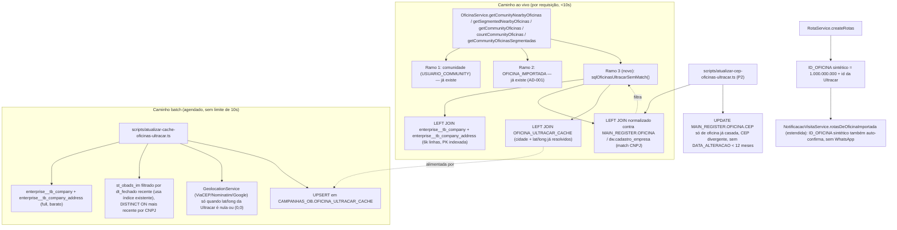

# Base de Oficinas da Ultracar nos Promotores Design

**Spec**: `.specs/features/ultracar-oficinas-promotores/spec.md`
**Status**: Draft

**Decisão de escopo confirmada com o usuário**: oficina Ultracar sem match entra no cálculo de rota (`ROTA_PROMOTOR` é criada), mas **não** ganha exibição de nome/endereço/telefone nas telas que hoje fazem `JOIN` direto com `MAIN_REGISTER.OFICINA` (notificação de visita, WhatsApp, app do promotor) — exatamente o Out of Scope já aprovado em `spec.md`. A rota existe; a experiência de confirmação por WhatsApp, não (ver Componente 5).

---

## Investigação em produção (read-only, via `scripts/db-query.ts`/`AppDataSourceSync`)

Antes de desenhar a arquitetura, consultei `ultracar_process` (só `SELECT`) para substituir suposição por dado. Achados que mudam o desenho:

| Achado | Dado medido | Impacto no desenho |
|---|---|---|
| `st_obads_im` é enorme e sem índice útil | ~12,69 milhões de linhas; único índice relevante é `dt_fechado` (nenhum em `cnpj`, `id_oficina` ou `cep`) | `COUNT(*)` nela já estourou o timeout de 10s numa consulta de teste. **Nunca** pode ser consultada ao vivo por requisição — só em job batch, fora do caminho de request |
| `enterprise__tb_company`/`enterprise__tb_company_address` são pequenas | 6.093 e 6.103 linhas, cada uma com PK indexada | Seguro fazer `JOIN` ao vivo por requisição |
| `zipcode__tb_city` existe mas está **vazia** (0 linhas) | `city_id` de `enterprise__tb_company_address` não resolve nome de cidade por nenhuma chave testada (`id` nem `code_ibge`) | Cidade só vem de `st_obads_im.cidade` — confirma o que o usuário descreveu, mas via job batch, não via JOIN ao vivo |
| Coordenadas de `enterprise__tb_company_address` majoritariamente inválidas | De 6.103 linhas: 1.160 nulas, 4.856 em `(0,0)` (sentinela), só **87 (1,4%) usáveis** | Depender da lat/long da Ultracar ao vivo deixaria quase toda oficina sem raio. Precisa de geocodificação por CEP num job batch (reaproveitando `GeolocationService`), nunca ao vivo |
| `EXISTS`/`OR` correlacionado contra `dw.cadastro_empresa` estoura o timeout mesmo com a Ultracar do lado pequeno | Testei o matching com `EXISTS` por linha: **timeout**. Reescrito como `LEFT JOIN` com CTEs normalizadas (mesmo padrão de `utils/sqlCadastroEmpresa.ts`): **~2s** para as 4.612 oficinas ativas da Ultracar inteiras | Confirma empiricamente o comentário já existente em `sqlCadastroEmpresa.ts` sobre `EXISTS`/`OR` custarem nested loop. O match ao vivo é viável, mas só na forma de `LEFT JOIN` explícito |
| Taxa de match real | Das 4.612 oficinas ativas da Ultracar: 2.405 (52%) já têm CNPJ na nossa base; **2.207 (48%) são novas** | Dimensiona o volume que a UNION nova precisa cobrir — não é uma cauda irrelevante |
| `id` da Ultracar colide com `ID_OFICINA` nosso | `MAIN_REGISTER.OFICINA` vai até `426.254`; `enterprise__tb_company.id` vai de `163` a `50.004.344`, com **2.695 valores abaixo de 10 milhões** | Não dá para reusar o `id` da Ultracar direto como `ID_OFICINA` sintético — precisa de offset (ver Tech Decisions) |
| CEP sempre presente | 0 de 6.103 linhas de `enterprise__tb_company_address` sem `zip_code` | O script de correção de CEP (P2) não vai esbarrar em CEP vazio do lado da Ultracar |

---

## Architecture Overview

Nenhuma oficina da Ultracar é copiada para `MAIN_REGISTER.OFICINA`. A visibilidade acontece por um terceiro ramo de `UNION ALL`, ao lado dos dois que já existem (comunidade via `USUARIO_COMMUNITY`, e `OFICINA_IMPORTADA` — AD-001), nas 5 consultas de `OficinaService` que o módulo de promotores usa.

O ramo novo nunca toca `ultracar_process.st_obads_im` nem geocodifica ao vivo: ele lê de uma tabela de cache pequena (`CAMPANHAS_OB.OFICINA_ULTRACAR_CACHE`), alimentada por um job batch agendado que é o único lugar que varre `st_obads_im` e chama o geocodificador.



---

## Code Reuse Analysis

### Existing Components to Leverage

| Component | Location | How to Use |
|---|---|---|
| `cnpjIntDaOficina`, `cnpjIntParaLigacao`, `ligacaoCadastroEmpresa` | `utils/sqlCadastroEmpresa.ts` | Mesma convenção de normalização/ligação de CNPJ para decidir "match" entre oficina Ultracar e `OFICINA`/`dw.cadastro_empresa` — nunca uma regra nova |
| `sqlOficinaImportada` e os 2 ramos `UNION ALL` de `getComunityNearbyOficinas`/`getCommunityOficinas`/`countCommunityOficinas`/`getCommunityOficinasSegmentadas`/`getSegmentedNearbyOficinas` | `service/oficinaService.ts` | Template literal do 3º ramo: mesmas colunas de saída (`ID_OFICINA`, `LATITUDE`, `LONGITUDE`, `NOME_FANTASIA`, `ENDERECO`, `BAIRRO`, `CIDADE`, `ESTADO`, `NUMERO`, `CEP`, `CNPJ`, `TELEFONE`), `TELEFONE` sempre `NULL` |
| `GeolocationService` (ViaCEP → Nominatim → Google Maps, 1 req/s) | `service/geolocationService.ts` | Reaproveitado pelo job batch para geocodificar CEP quando a Ultracar não tem lat/long usável |
| Esqueleto de script com `--teste[=N]`, cache por CEP, execução sequencial | `scripts/atualizar-lat-long-comunidade.ts` | Template de CLI para os dois scripts novos (cache de oficinas e correção de CEP) |
| `rotasDeOficinaImportada` + registro automático com `ORIGEM_ACEITE=IMPORTADA` | `service/notificacaoVisitaService.ts:444-461` | Estendido com uma condição irmã para `ID_OFICINA` no intervalo sintético da Ultracar — mesma mecânica, sem WhatsApp para oficina sem usuário/telefone |
| `scripts/db-query.ts` | `scripts/db-query.ts` | Console read-only já existente — usado nesta investigação e reaproveitável para qualquer conferência futura (`SELECT` apenas, transação sempre revertida) |
| AD-001 (`.specs/STATE.md`) | — | Este design conforma à decisão existente: oficina sem linha real em `OFICINA`/`USUARIO_COMMUNITY` é resolvida por `UNION ALL` num método de leitura, nunca por registro sintético nas tabelas de usuário/comunidade |

### Integration Points

| System | Integration Method |
|---|---|
| `ultracar_process.enterprise__tb_company` / `enterprise__tb_company_address` | `LEFT JOIN` ao vivo pela PK (`address_id` → `id`), schema já acessível pela mesma `AppDataSourceSync` (mesmo Postgres físico de `MAIN_REGISTER`/`dw`) |
| `ultracar_process.st_obads_im` | Só no job batch, nunca ao vivo; filtrado por `dt_fechado` (índice existente) para não varrer as 12,69M linhas inteiras a cada execução |
| `dw.cadastro_empresa` / `MAIN_REGISTER.OFICINA` | `LEFT JOIN` ao vivo com CTE normalizada (nunca `EXISTS`/`OR`) para decidir match de CNPJ |
| `CAMPANHAS_OB.OFICINA_ULTRACAR_CACHE` (nova) | Lida ao vivo pelas 5 consultas de `OficinaService`; escrita só pelo job batch |
| `CAMPANHAS_OB.NOTIFICACAO_VISITA` | `rotasDeOficinaImportada` estendida grava `ORIGEM_ACEITE` novo para rota de oficina Ultracar sem match |
| `CAMPANHAS_OB.ROTA_PROMOTOR` | Sem mudança de schema — `ID_OFICINA` já é `int` sem FK física (mesmo padrão de `OFICINA_IMPORTADA`), recebe o id sintético normalmente |

---

## Components

### `OficinaUltracarService` (novo)

- **Purpose**: Único ponto que conhece o schema `ultracar_process`, a tabela de cache e o esquema de ID sintético — isola essa complexidade do resto do `OficinaService`.
- **Location**: `service/oficinaUltracarService.ts`
- **Interfaces**:
  - `sqlOficinasUltracarSemMatch(empresaSlugParam: string | null): string` - fragmento SQL do 3º ramo `UNION ALL` (mesmas colunas que os outros 2 ramos); `empresaSlugParam` existe só pela forma do `UNION`, a condição de match **não** filtra por `EMPRESA_SLUG` (unmatched aparece pra qualquer cliente, ULTRACAR-01/02)
  - `ID_OFICINA_ULTRACAR_OFFSET: number` - constante `1_000_000_000`
  - `idOficinaSintetico(ultracarCompanyId: number): number` - `OFFSET + ultracarCompanyId`
  - `ehIdOficinaUltracar(idOficina: number): boolean` - `idOficina >= OFFSET`
  - `ultracarCompanyIdDoSintetico(idOficina: number): number | null` - inverso, `null` se fora da faixa
- **Dependencies**: `AppDataSourceSync`, `utils/sqlCadastroEmpresa.ts` (CTEs de normalização de CNPJ)
- **Reuses**: mesmo padrão de função geradora de fragmento SQL que `sqlOficinaImportada`/`sqlRecusouNaCampanha` em `oficinaService.ts`

### `service/oficinaService.ts` (estendido, não novo)

- **Purpose**: Cada um dos 5 métodos de comunidade ganha um 3º ramo no `UNION ALL` existente, chamando `OficinaUltracarService.sqlOficinasUltracarSemMatch()`.
- **Location**: `service/oficinaService.ts` — `getComunityNearbyOficinas`, `getSegmentedNearbyOficinas`, `getCommunityOficinas`, `countCommunityOficinas`, `getCommunityOficinasSegmentadas`
- **Interfaces**: assinaturas públicas **inalteradas** (requisito de não mexer em contrato de API cobre também a forma interna que os controllers já consomem)
- **Dependencies**: `OficinaUltracarService`
- **Reuses**: a estrutura `SELECT DISTINCT ON (...) * FROM (ramo1 UNION ALL ramo2 UNION ALL ramo3) combinado` já existente em cada método

### `scripts/atualizar-cache-oficinas-ultracar.ts` (novo)

- **Purpose**: Job batch agendado que popula `CAMPANHAS_OB.OFICINA_ULTRACAR_CACHE` — único lugar que varre `st_obads_im` e chama geocodificação.
- **Location**: `scripts/atualizar-cache-oficinas-ultracar.ts`
- **Interfaces**: CLI `npx ts-node scripts/atualizar-cache-oficinas-ultracar.ts [--teste[=N]]`
- **Dependencies**: `GeolocationService`, `AppDataSourceSync`
- **Reuses**: esqueleto de `scripts/atualizar-lat-long-comunidade.ts` (modo teste, cache por CEP, 1 req/s sequencial, relatório de diagnóstico)
- **Comportamento**:
  1. `SELECT` de todas as `enterprise__tb_company` ativas + `enterprise__tb_company_address` (barato, ~6k linhas)
  2. Para cidade/estado/CEP "de uso": `DISTINCT ON (cnpj) ...  FROM ultracar_process.st_obads_im WHERE dt_fechado > now() - interval '24 months' ORDER BY cnpj, dt_fechado DESC` — usa o índice existente em `dt_fechado` pra não varrer as 12,69M linhas inteiras; oficina sem invoice recente mantém o valor já cacheado (não é removida nem zerada)
  3. Lat/long: usa `enterprise__tb_company_address` quando não é nula nem `(0,0)`; senão geocodifica o `zip_code` via `GeolocationService`
  4. `UPSERT` em `OFICINA_ULTRACAR_CACHE` por `ultracar_company_id`

### `scripts/atualizar-cep-oficinas-ultracar.ts` (novo, P2)

- **Purpose**: Corrige `MAIN_REGISTER.OFICINA.CEP` de oficinas já casadas por CNPJ, cujo CEP diverge do `zip_code` da Ultracar, respeitando a janela de 12 meses sem atualização cadastral.
- **Location**: `scripts/atualizar-cep-oficinas-ultracar.ts`
- **Interfaces**: CLI `npx ts-node scripts/atualizar-cep-oficinas-ultracar.ts [--teste[=N]]`
- **Dependencies**: `AppDataSourceSync`, `utils/sqlCadastroEmpresa.ts`
- **Reuses**: mesmo esqueleto `--teste[=N]` de `scripts/atualizar-lat-long-comunidade.ts`
- **Candidata** = `OFICINA` com CNPJ casado em `enterprise__tb_company` (CTE normalizada), `OFICINA.CEP` (dígitos) ≠ `enterprise__tb_company_address.zip_code` (dígitos), e `OFICINA.DATA_ALTERACAO IS NULL OR DATA_ALTERACAO < now() - interval '12 months'`

### `service/notificacaoVisitaService.ts` (estendido)

- **Purpose**: Rota cuja oficina é um id sintético da Ultracar auto-confirma como `OFICINA_IMPORTADA` já faz — sem fila de WhatsApp pra um número que não existe.
- **Location**: `service/notificacaoVisitaService.ts:444-461` (`rotasDeOficinaImportada`)
- **Interfaces**: adiciona condição `OR rp."ID_OFICINA" >= 1000000000` (ou função irmã `rotasDeOficinaUltracar`, unida ao `Set` existente) dentro de `registrarRotasCriadas`
- **Dependencies**: `OrigemAceite` (novo valor `ULTRACAR`, DDL manual)
- **Reuses**: a própria `rotasDeOficinaImportada`/`registrarRotasCriadas` — nenhuma lógica nova de confirmação, só um critério a mais pra cair no mesmo caminho

---

## Data Models

### `CAMPANHAS_OB.OFICINA_ULTRACAR_CACHE` (nova tabela — DDL manual)

```typescript
interface OficinaUltracarCache {
  ID_OFICINA_ULTRACAR_CACHE: number;      // PK serial
  ULTRACAR_COMPANY_ID: number;            // enterprise__tb_company.id (bigint na origem, cabe em bigint aqui)
  CNPJ: string;                           // só dígitos, 14 caracteres
  NOME_FANTASIA: string | null;
  ENDERECO: string | null;                // street + number da company_address
  BAIRRO: string | null;                  // district
  CIDADE: string | null;                  // de st_obads_im (job batch), pode ficar null se nunca teve invoice
  ESTADO: string | null;
  CEP: string;                            // zip_code, nunca nulo (confirmado: 0/6.103 nulos)
  LATITUDE: number | null;                // da company_address quando válida, senão geocodificada
  LONGITUDE: number | null;
  ATIVO: boolean;                         // company.active
  ATUALIZADO_EM: Date;                    // quando o job rodou por último para esta linha
}
```

**Relationships**: `ULTRACAR_COMPANY_ID` é único (índice único) — é a chave do `UPSERT` do job batch. Não tem FK física para `ultracar_process` (schema externo, sem DDL neste repo, mesmo padrão de `dw.cadastro_empresa`). O `ID_OFICINA` sintético usado em `ROTA_PROMOTOR`/respostas de API é derivado (`1_000_000_000 + ULTRACAR_COMPANY_ID`), nunca a PK desta tabela.

**Por que uma tabela nova em vez de ler `ultracar_process` direto na query de leitura**: `st_obads_im` (cidade) não pode ser tocada ao vivo (12,69M linhas, sem índice útil) e a geocodificação (quando a Ultracar não tem lat/long usável — 98,6% dos casos) não pode rodar por requisição (rate limit de 1 req/s do Nominatim). A tabela de cache é o único jeito de manter o caminho de leitura dentro de 10s sem depender da qualidade de dado da origem.

---

## Error Handling Strategy

| Error Scenario | Handling | User Impact |
|---|---|---|
| `st_obads_im` sem invoice recente para uma oficina (sem `CIDADE`/`ESTADO` no cache) | Job batch mantém a linha no cache com `CIDADE`/`ESTADO` nulos; consulta ao vivo simplesmente devolve esses campos nulos (contrato já tolera nulo nesses campos para outras fontes) | Oficina aparece sem cidade/estado preenchidos, não desaparece |
| Geocodificação falha pro CEP da Ultracar (nenhum provedor resolve) | Job batch mantém `LATITUDE`/`LONGITUDE` nulos para a linha; consultas com filtro de raio excluem a linha (AC4), consultas sem raio (`getCommunityOficinas`) ainda a incluem | Oficina não aparece em busca por raio, mas aparece em listagem sem raio |
| `ultracar_process` indisponível (schema fora do ar) durante o job batch | Job falha, loga e não faz `UPSERT` parcial — cache mantém o último estado bom conhecido | Nenhum, cache simplesmente não atualiza até a próxima execução |
| `ultracar_process` indisponível durante a consulta ao vivo (`enterprise__tb_company`/`_address`, que são consultadas ao vivo) | Consulta falha (mesmo tratamento de erro já existente nos 5 métodos — `try/catch` + log + `throw`) | Erro 500 na tela de promotor, igual hoje se `MAIN_REGISTER.OFICINA` cair |
| Rota criada para `ID_OFICINA` sintético, notificação tenta resolver oficina em `despacharNotificacao` | Já tratado pelo código existente: `oficina === null` → `encerrarTerminal(..., MOTIVO_OFICINA_INEXISTENTE)`, sem lançar exceção (confirmado em `notificacaoVisitaService.ts:512-518`) | Nenhum visível — mitigado também pela extensão de `rotasDeOficinaImportada` (Componente 5), que evita a notificação ser sequer enfileirada |
| CNPJ duplicado dentro de `ultracar_process` (mesmo CNPJ, `id` diferente — 841 casos observados) | Job batch usa `DISTINCT ON (cnpj_normalizado) ORDER BY ... ultracar_company_id DESC` (critério de desempate simples e determinístico) ao montar o cache | Uma linha por CNPJ no cache, sem oficina duplicada na UNION |
| Script de CEP roda em modo teste | Só lista candidatas e os dois CEPs, nenhum `UPDATE` | Nenhum — é a validação antes do real |

---

## Risks & Concerns

| Concern | Location (file:line) | Impact | Mitigation |
|---|---|---|---|
| `st_obads_im` sem índice em `cnpj`/`id_oficina`/`cep` (12,69M linhas) | `ultracar_process.st_obads_im` (schema externo, sem DDL neste repo) | Qualquer leitura por requisição estoura o timeout de 10s (confirmado: `COUNT(*)` já estourou) | Nunca consultada ao vivo; só no job batch, filtrado pelo índice existente em `dt_fechado` |
| Qualidade de coordenada da Ultracar é muito baixa (1,4% usável) | `ultracar_process.enterprise__tb_company_address.latitude/longitude` | Sem geocodificação, quase nenhuma oficina nova apareceria em busca por raio — a feature teria valor prático baixo | Job batch geocodifica via `GeolocationService` (CEP) quando lat/long é nula ou `(0,0)`, armazenando no cache |
| `EXISTS`/`OR` correlacionado contra `dw.cadastro_empresa` estoura timeout mesmo com tabela pequena do lado de fora | Testado isoladamente nesta investigação (não é um arquivo do repo) | Risco real de reintroduzir o mesmo problema se a query de match for escrita do jeito "óbvio" | Tech Decision explícita abaixo: sempre `LEFT JOIN` com CTE normalizada, nunca `EXISTS`/`OR`, replicando o padrão já documentado em `utils/sqlCadastroEmpresa.ts:28-36` |
| Rota criada para oficina sem telefone pode ficar pendurada em fila de notificação até falhar | `service/notificacaoVisitaService.ts:389-441` (`registrarRotasCriadas`) | Ruído operacional (notificação enfileirada que sempre falha), não quebra nada, mas é trabalho/log desnecessário | Componente 5: estende `rotasDeOficinaImportada` para também auto-confirmar id sintético da Ultracar, do mesmo jeito que já faz pra `OFICINA_IMPORTADA` |
| `matrix_id`/multi-linha por CNPJ na Ultracar (841 CNPJs duplicados entre 6.093 empresas) | `ultracar_process.enterprise__tb_company` | Sem desempate, a mesma oficina física poderia entrar 2x na UNION | Mitigado no job batch com `DISTINCT ON` determinístico (ver Error Handling) — a UNION ao vivo lê da cache já deduplicada |
| Nenhum teste de integração cobre hoje as 5 consultas de `OficinaService` com mock de 3 ramos de `UNION` | `service/oficinaService.ts`, `__tests__/integration/oficinaService.test.ts` | Regressão silenciosa nos ramos existentes (comunidade, importada) ao adicionar o 3º ramo | Tasks deve cobrir os 3 ramos juntos e isolados (lição confirmada L-004: testar o SQL, não só a linha simulada) |

> Nenhum risco de segurança novo identificado: a leitura de `ultracar_process` é só `SELECT`, mesma credencial/conexão já usada para `dw`/`MAIN_REGISTER`.

---

## Tech Decisions (only non-obvious ones)

| Decision | Choice | Rationale |
|---|---|---|
| ID sintético de `ID_OFICINA` para oficina Ultracar sem match | `1_000_000_000 + ultracar_company_id` | `MAIN_REGISTER.OFICINA` vai até 426.254 hoje; faixa reservada a partir de 1 bilhão não colide em nenhum cenário razoável de crescimento, cabe em `int4` (máx. ~2,147 bilhões), e é reversível (subtrair o offset recupera o id original da Ultracar) |
| Cidade/estado/CEP "de uso" da Ultracar | Vem de `st_obads_im`, só via job batch (nunca ao vivo) | É a única fonte real (`zipcode__tb_city` está vazia); a tabela é grande demais e sem índice útil para leitura por requisição |
| Lat/long da Ultracar | `enterprise__tb_company_address` quando válida (não nula, não `(0,0)`), senão geocodificação via `GeolocationService` no job batch | Medido: só 1,4% das linhas têm par usável direto na origem |
| Forma da query de match de CNPJ | `LEFT JOIN` com CTE normalizada, nunca `EXISTS`/`OR` correlacionado | Medido nesta investigação: a versão com `EXISTS` estourou o timeout de 10s; a reescrita como `LEFT JOIN` rodou em ~2s para a base Ultracar inteira |
| Onde fica o "é Ultracar sem match" | Calculado **ao vivo** a cada leitura (comparando CNPJ da cache contra `OFICINA`/`dw` no momento da consulta), nunca cacheado como flag | `OFICINA` muda com mais frequência que o cache da Ultracar (ex.: importação de planilha pode cadastrar uma oficina que ontem não tinha match) — cachear o flag arriscaria mostrar uma oficina já cadastrada como se fosse "nova" |
| Auto-confirmação de rota para oficina sem telefone | Estende `rotasDeOficinaImportada` em vez de criar um fluxo de confirmação paralelo | Reaproveita mecanismo já existente e testado para o mesmo problema (oficina sem usuário/telefone) — `OFICINA_IMPORTADA` |

> **Project-level decisions:** as linhas 1, 2, 3 e 4 desta tabela valem para qualquer feature futura que precise ler `ultracar_process` ou replicar o padrão de "oficina sem linha real" — vão para `.specs/STATE.md` como `AD-010` (ver abaixo).

---

## Tips

(seção de referência do template, sem conteúdo específico desta feature)
