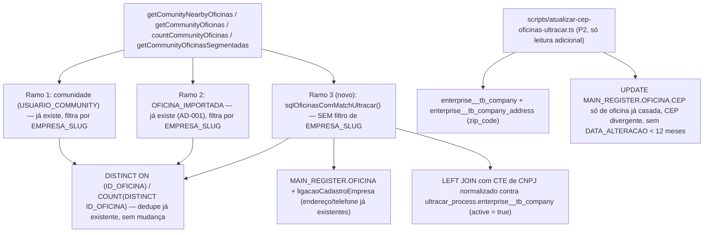
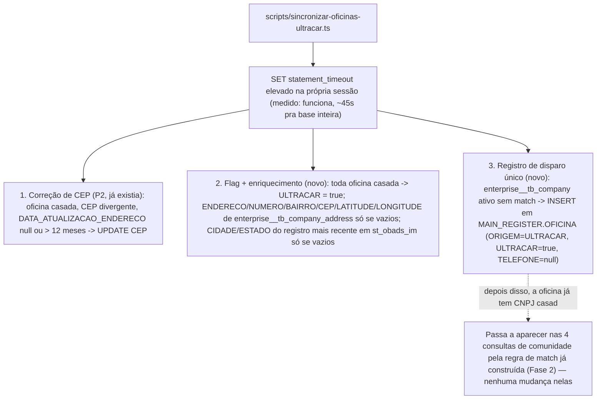

# Base de Oficinas da Ultracar nos Promotores Design

**Spec**: `.specs/features/ultracar-oficinas-promotores/spec.md`
**Status**: Draft

**Nota de revisão**: este design substitui a versão anterior depois que o usuário inverteu a regra de visibilidade (ver spec.md): só oficina **com** match de CNPJ passa a ter bypass de comunidade; oficina **sem** match não aparece em nada. Isso elimina quase toda a complexidade do design anterior — cache de endereço, geocodificação e id sintético deixaram de ser necessários, porque a oficina com match já é uma linha real de `MAIN_REGISTER.OFICINA` com endereço/telefone próprios. O que continua valendo da investigação anterior (medida em produção, só `SELECT`) está resumido abaixo; detalhe completo da investigação ficou no histórico de `design.md` (commit anterior) e em `.specs/STATE.md` (AD-010).

---

## O que a investigação anterior ainda entrega para este design

| Achado (medido, não presumido) | Uso neste design |
|---|---|
| `EXISTS`/`OR` correlacionado contra `dw.cadastro_empresa` estourou o timeout de 10s; reescrito como `LEFT JOIN` com CTE normalizada rodou em ~2s para a base Ultracar inteira (4.612 oficinas ativas) | É exatamente a forma de query que decide "tem match" aqui — ver Tech Decisions e AD-010 (`.specs/STATE.md`), ponto 2 |
| `enterprise__tb_company` (6.093 linhas) e `enterprise__tb_company_address` (6.103 linhas) são pequenas, com PK indexada | Seguro consultar ao vivo. `enterprise__tb_company` entra na query de match (este design); `enterprise__tb_company_address` só é usada pelo script de CEP (P2), não no caminho de leitura ao vivo |
| `st_obads_im` (12,69M linhas, sem índice em `cnpj`/`id_oficina`/`cep`) | **Não é mais necessária nesta spec.** Só servia para endereço/cidade de oficina sem match — que não aparece mais. AD-010 ponto 1 (nunca consultar ao vivo) continua válido como regra geral, só não é exercido por este design |
| Id da Ultracar colide com `ID_OFICINA` (faixas se sobrepõem) | **Não é mais necessário.** Oficina com match usa seu `ID_OFICINA` real — não existe mais id sintético a inventar. AD-010 ponto 3 fica como referência pra uma eventual feature futura, não usado aqui |
| Taxa de match real: 2.405 de 4.612 oficinas ativas da Ultracar (52%) já têm CNPJ na nossa base | É exatamente o universo que passa a ganhar bypass de comunidade — dimensiona o volume do novo ramo da `UNION` |

---

## Investigação adicional (CON26-408)

O Jira pede medir a sobreposição real por CNPJ especificamente via `ultracar_process.st_obads_im` (não `enterprise__tb_company`) — medido abaixo, mesma régua de só `SELECT`.

| Achado | Dado medido | Impacto no desenho |
|---|---|---|
| Sobreposição real via `st_obads_im` | 3.652 CNPJs distintos no total; **1.988 (54%) já têm match** em `OFICINA`/`dw`; **1.664 (46%) não têm** | Número oficial do critério de aceite "medir a sobreposição real" — cabe no Goals de `spec.md`. Universo menor que `enterprise__tb_company` (6.093 linhas) porque só conta quem já gerou nota fiscal |
| `st_obads_im` nega até um `COUNT(*)` simples com filtro no índice de `dt_fechado` sob o timeout padrão | `WHERE dt_fechado > now() - interval '3 months'` (1.47M linhas) estourou com o timeout de sessão padrão; só terminou (22s) depois de elevar o `statement_timeout` da própria sessão para 180s | Confirma AD-010 ponto 1 com mais força: não é só "não indexado para `cnpj`", a tabela é grande demais pra **qualquer** filtro cobrir em 10s. Nenhum script que toque essa tabela pode depender do timeout padrão |
| É possível elevar `statement_timeout` por sessão nesta role de banco | `SET statement_timeout = '600000'` funcionou sem erro de permissão; a medição completa (`DISTINCT` + normalização + 2 `LEFT JOIN`) rodou em 44,6s | Mecanismo concreto para os scripts de disparo único/batch desta feature: abrir a conexão do script com `SET statement_timeout` elevado (ex.: 10-15 min) antes de tocar `st_obads_im` — nunca herdar o timeout de 10s pensado para consulta de request |
| `MAIN_REGISTER.OFICINA` tem um campo de data dedicado a endereço | `"DATA_ATUALIZACAO_ENDERECO"` (criado pelo backend-communities, comentário na entidade: "Último ponto em que o endereço foi confirmado") | **Corrige** a spec anterior: a janela de 12 meses do script de CEP (P2) deve usar este campo, não `DATA_ALTERACAO` (genérico, muda a qualquer edição da linha e geraria falso-negativo) |

---

## Architecture Overview

Um terceiro ramo de `UNION ALL`, ao lado dos dois que já existem (comunidade via `USUARIO_COMMUNITY`, e `OFICINA_IMPORTADA` — AD-001), nos métodos de `OficinaService` que filtram por `EMPRESA_SLUG`. O ramo novo seleciona de `MAIN_REGISTER.OFICINA` (com o mesmo `ligacaoCadastroEmpresa` que os outros ramos já usam) — **sem** filtro de `EMPRESA_SLUG` — restrito a oficinas cujo CNPJ bate com uma linha ativa de `ultracar_process.enterprise__tb_company`. O `DISTINCT ON ("ID_OFICINA")`/`COUNT(DISTINCT "ID_OFICINA")` que cada método já usa para combinar os ramos faz a deduplicação de graça — nenhuma lógica nova de dedupe é necessária.



`ultracar_process.enterprise__tb_company_address` e `ultracar_process.st_obads_im` **não** entram no caminho de leitura ao vivo — só são lidas pelos scripts batch abaixo (fora do request path, com `statement_timeout` de sessão elevado).

### Fluxo batch (CON26-408): flag + enriquecimento + registro de disparo único

Um único script (`scripts/sincronizar-oficinas-ultracar.ts`), com 3 responsabilidades sequenciais, cada uma com seu próprio modo de teste:



---

## Code Reuse Analysis

### Existing Components to Leverage

| Component | Location | How to Use |
|---|---|---|
| `cnpjIntDaOficina`, `cnpjIntParaLigacao`, `ligacaoCadastroEmpresa` | `utils/sqlCadastroEmpresa.ts` | Mesma convenção de normalização/ligação de CNPJ — a oficina com match usa exatamente o endereço/telefone que esse helper já resolve, sem nenhum dado novo |
| Os 2 ramos `UNION ALL` já existentes em `getComunityNearbyOficinas`/`getCommunityOficinas`/`countCommunityOficinas` | `service/oficinaService.ts` | Template literal do 3º ramo: mesmas colunas de saída. Como o 3º ramo lê só de `OFICINA`/`dw`, as colunas batem exatamente com o ramo 1 (comunidade), bastando reaproveitar a mesma projeção |
| `DISTINCT ON ("ID_OFICINA")` / `COUNT(DISTINCT "ID_OFICINA")` | `service/oficinaService.ts` (wrapper externo de cada método) | Dedupe entre os 3 ramos já é automático — oficina que está em comunidade E tem match Ultracar aparece uma vez só, sem código novo |
| `scripts/atualizar-lat-long-comunidade.ts` (esqueleto `--teste[=N]`) | `scripts/atualizar-lat-long-comunidade.ts` | Template de CLI para o script `sincronizar-oficinas-ultracar.ts` (CEP + flag/enriquecimento + registro) |
| AD-001 (`.specs/STATE.md`) | — | Este design conforma à decisão existente de representar oficina "fora do caminho normal" por `UNION ALL` num método de leitura |
| AD-010 (`.specs/STATE.md`), ponto 2 | — | A query de match usa `LEFT JOIN` com CTE normalizada, nunca `EXISTS`/`OR` — regra já medida e registrada |
| AD-010 (`.specs/STATE.md`), ponto 1 (agora exercido) | — | O script batch toca `st_obads_im`, mas nunca no caminho de request — eleva seu próprio `statement_timeout` de sessão (ver Investigação adicional) |
| `scripts/migration-oficina-importada.sql` (estilo de DDL manual) | `scripts/migration-oficina-importada.sql` | Template da nova DDL (`ALTER TABLE ... ADD COLUMN`), também `CREATE ... IF NOT EXISTS`, comentário "aplicar manualmente" no topo |
| `entities/Oficina.ts` | `entities/Oficina.ts` | Ganha a coluna `ULTRACAR` (boolean), mesmo padrão das colunas existentes |

### Integration Points

| System | Integration Method |
|---|---|
| `ultracar_process.enterprise__tb_company` | `LEFT JOIN` ao vivo (CTE de CNPJ normalizado) nos 4 métodos em escopo — tabela pequena (6.093 linhas), PK indexada |
| `MAIN_REGISTER.OFICINA` / `dw.cadastro_empresa` | Fonte única de exibição (nome, endereço, telefone, coordenadas) — reaproveita `ligacaoCadastroEmpresa` sem mudança |
| `ultracar_process.enterprise__tb_company_address` | Lida pelo script batch (CEP, enriquecimento de endereço e registro), fora do caminho de request |
| `ultracar_process.st_obads_im` | Lida só pelo script batch, com `statement_timeout` de sessão elevado — nunca ao vivo (CIDADE/ESTADO para enriquecimento e registro) |
| `MAIN_REGISTER.OFICINA` (escrita) | `UPDATE` (CEP, enriquecimento, flag) e `INSERT` (registro de disparo único) — sempre pelo script batch, nunca pelo caminho de leitura ao vivo |

---

## Components

### `OficinaUltracarService` (novo, bem menor que a versão anterior)

- **Purpose**: Único ponto que conhece `ultracar_process.enterprise__tb_company` — isola essa dependência do resto do `OficinaService`.
- **Location**: `service/oficinaUltracarService.ts`
- **Interfaces**:
  - `sqlOficinasComMatchUltracar(aliasOficina?: string): string` - fragmento SQL do 3º ramo `UNION ALL`: `SELECT <mesmas colunas do ramo 1> FROM "MAIN_REGISTER"."OFICINA" o<ligacaoCadastroEmpresa> WHERE <CNPJ normalizado de o> IN (SELECT <CNPJ normalizado> FROM ultracar_process.enterprise__tb_company WHERE active = true)` reescrito como `LEFT JOIN`/CTE (nunca `EXISTS`/`IN` correlacionado) — sem filtro de `EMPRESA_SLUG`
- **Dependencies**: `AppDataSourceSync`, `utils/sqlCadastroEmpresa.ts`
- **Reuses**: mesmo padrão de função geradora de fragmento SQL que `sqlOficinaImportada` em `oficinaService.ts`

### `service/oficinaService.ts` (estendido, não novo)

- **Purpose**: Cada um dos 4 métodos filtrados por `EMPRESA_SLUG` ganha um 3º ramo no `UNION ALL` existente.
- **Location**: `service/oficinaService.ts` — `getComunityNearbyOficinas`, `getCommunityOficinas`, `countCommunityOficinas`, `getCommunityOficinasSegmentadas`
- **Interfaces**: assinaturas públicas **inalteradas**
- **Dependencies**: `OficinaUltracarService`
- **Reuses**: a estrutura `SELECT DISTINCT ON (...) * FROM (ramo1 UNION ALL ramo2 UNION ALL ramo3) combinado` já existente em 3 dos 4 métodos
- **Nota**: `getCommunityOficinasSegmentadas` hoje **não** tem o ramo `OFICINA_IMPORTADA` (só o ramo de comunidade) — inconsistência pré-existente, fora do pedido desta spec. Para ela, o 3º ramo (Ultracar) é adicionado como uma `UNION ALL` nova com o wrapper `DISTINCT ON` que os outros 3 métodos já têm; a ausência do ramo `OFICINA_IMPORTADA` nessa função continua como está, sem alteração

### `scripts/migration-ultracar-flag-oficina.sql` (novo, DDL manual)

- **Purpose**: Adiciona a coluna `"ULTRACAR"` em `MAIN_REGISTER.OFICINA`. Nunca executado automaticamente — gerado para o usuário rodar manualmente, mesmo padrão de `scripts/migration-oficina-importada.sql`.
- **Location**: `scripts/migration-ultracar-flag-oficina.sql`
- **Conteúdo**: `ALTER TABLE "MAIN_REGISTER"."OFICINA" ADD COLUMN IF NOT EXISTS "ULTRACAR" boolean NOT NULL DEFAULT false;` + índice parcial `WHERE "ULTRACAR" = true` (barato, só as linhas marcadas)
- **Reuses**: comentário de cabeçalho "aplicar manualmente" + `IF NOT EXISTS`, como em `migration-oficina-importada.sql`

### `entities/Oficina.ts` (estendido)

- **Purpose**: Expor a nova coluna ao TypeORM.
- **Location**: `entities/Oficina.ts`
- **Mudança**: `@Column({ type: "boolean", default: false, name: "ULTRACAR" }) ULTRACAR?: boolean;`
- **Nota de contrato**: este campo **não** é adicionado a nenhum DTO/resposta de API (requisito "contrato não muda" continua valendo) — é lido só pelos scripts e, se algum dia for exposto, isso é uma spec própria

### `scripts/sincronizar-oficinas-ultracar.ts` (novo — substitui o `atualizar-cep-oficinas-ultracar.ts` do design anterior, escopo ampliado pelo CON26-408)

- **Purpose**: Único script com as 3 responsabilidades batch desta feature, cada uma com seu próprio modo de teste e sua própria função de seleção de candidata (testável sem banco):
  1. **Correção de CEP** (P2, já desenhada antes): oficina casada, CEP divergente, `DATA_ATUALIZACAO_ENDERECO` nula ou > 12 meses → `UPDATE CEP`
  2. **Flag + enriquecimento** (novo, CON26-408): toda oficina casada → `ULTRACAR = true`; campos de endereço vazios (`ENDERECO`/`NUMERO`/`BAIRRO`/`CEP`/`LATITUDE`/`LONGITUDE` de `enterprise__tb_company_address`; `CIDADE`/`ESTADO` do registro mais recente de `st_obads_im`) → preenchidos só se vazios, nunca sobrescritos
  3. **Registro de disparo único** (novo, CON26-408): `enterprise__tb_company` ativo sem match → `INSERT` em `MAIN_REGISTER.OFICINA` (`ORIGEM = "ULTRACAR"`, `ULTRACAR = true`, `TELEFONE` nulo), idempotente por CNPJ
- **Location**: `scripts/sincronizar-oficinas-ultracar.ts`
- **Interfaces**: CLI `npx ts-node scripts/sincronizar-oficinas-ultracar.ts [--teste[=N]]` — modo de teste cobre as 3 responsabilidades no mesmo relatório, nenhuma grava nada
- **Dependencies**: `AppDataSourceSync` (com `statement_timeout` de sessão elevado antes de tocar `st_obads_im`), `utils/sqlCadastroEmpresa.ts`
- **Reuses**: esqueleto `--teste[=N]` de `scripts/atualizar-lat-long-comunidade.ts`
- **Candidata de correção de CEP** = `OFICINA` com CNPJ casado em `enterprise__tb_company` (CTE normalizada), `OFICINA.CEP` (dígitos) ≠ `enterprise__tb_company_address.zip_code` (dígitos, join por `address_id`), e `OFICINA.DATA_ATUALIZACAO_ENDERECO IS NULL OR DATA_ATUALIZACAO_ENDERECO < now() - interval '12 months'`
- **Candidata de enriquecimento** = toda `OFICINA` com CNPJ casado (sem janela de 12 meses — roda sempre que o campo estiver vazio)
- **Candidata de registro** = `enterprise__tb_company.active = true` sem CNPJ correspondente em `OFICINA` nem `dw.cadastro_empresa` (mesma CTE de match já usada em `OficinaUltracarService`)

---

## Data Models

Nenhuma tabela nova. A verificação de match ao vivo (Fase 2) continua sendo uma consulta (`LEFT JOIN`), não um dado persistido — ver Tech Decisions sobre por que não cachear o resultado do match.

A única mudança de schema (CON26-408) é uma coluna nova, via DDL manual:

```typescript
// MAIN_REGISTER.OFICINA — coluna nova
interface OficinaUltracarFlag {
  ULTRACAR: boolean; // NOT NULL DEFAULT false — true quando o CNPJ já casou com enterprise__tb_company em alguma execução do script batch
}
```

**Relationships**: nenhuma FK nova. `ULTRACAR = true` é metadado derivado (recalculável a qualquer momento reexecutando o script), não uma referência para `ultracar_process`.

---

## Error Handling Strategy

| Error Scenario | Handling | User Impact |
|---|---|---|
| `ultracar_process.enterprise__tb_company` indisponível durante a consulta ao vivo | Consulta falha (mesmo tratamento de erro já existente nos 4 métodos — `try/catch` + log + `throw`) | Erro 500 na tela de promotor, igual hoje se `MAIN_REGISTER.OFICINA` cair |
| CNPJ duplicado em `enterprise__tb_company` (franquia/matriz) | A condição de match é "existe ao menos uma linha ativa com esse CNPJ" — não precisa de `DISTINCT ON`/desempate, porque o resultado de interesse é só a oficina nossa (`MAIN_REGISTER.OFICINA`), não uma linha da Ultracar | Nenhum — a oficina nossa aparece uma vez, igual a qualquer outro ramo |
| CNPJ duplicado em `MAIN_REGISTER.OFICINA` (caso já conhecido do sistema) | Sem regra nova — mesma situação que já existe hoje para qualquer consulta que ligue por CNPJ | Sem mudança de comportamento |
| Script de CEP roda em modo teste | Só lista candidatas e os dois CEPs, nenhum `UPDATE` | Nenhum — é a validação antes do real |
| `st_obads_im` sem registro para o CNPJ (enriquecimento ou registro) | `CIDADE`/`ESTADO` ficam nulos — não bloqueia o `UPDATE`/`INSERT` dos demais campos | Oficina criada/enriquecida sem cidade/estado, reportado no relatório do script |
| `enterprise__tb_company_address` sem endereço pro CNPJ a registrar | Oficina é criada mesmo assim, só com `NOME_FANTASIA`/`CNPJ`/`ORIGEM`/`ULTRACAR` | Oficina sem endereço aparece na base, mas não entra em busca por raio (mesmo tratamento que qualquer `OFICINA` sem lat/long hoje) |
| Reexecução do script de registro (CNPJ já criado por execução anterior) | Candidata de registro já exige "sem match" — CNPJ recém-criado passa a ter match, então a segunda execução não o seleciona de novo | Idempotente por construção, sem precisar de controle externo de "já rodou" |
| `st_obads_im` nega até um `COUNT(*)` simples sob o timeout padrão de 10s | Script eleva `statement_timeout` da própria sessão (medido: funciona, ~45s pra base inteira) antes de qualquer consulta a `st_obads_im` | Nenhum — mitigação interna ao script, fora do caminho de request |

---

## Risks & Concerns

| Concern | Location (file:line) | Impact | Mitigation |
|---|---|---|---|
| `EXISTS`/`OR` correlacionado contra `dw.cadastro_empresa`/`enterprise__tb_company` reintroduziria o mesmo estouro de timeout já medido | Novo código em `service/oficinaUltracarService.ts` | Regressão de performance nas 4 consultas de comunidade (tela de promotor inteira) | Tech Decision explícita: sempre `LEFT JOIN` com CTE normalizada — confirmado em AD-010 (`.specs/STATE.md`) |
| `getCommunityOficinasSegmentadas` já não tem o ramo `OFICINA_IMPORTADA` (inconsistência pré-existente) | `service/oficinaService.ts:596-672` | Fora do pedido desta spec, mas o novo 3º ramo (Ultracar) destaca ainda mais a inconsistência (dois dos três métodos "irmãos" têm 3 ramos, este passa a ter 2) | Não corrigido aqui — registrado para visibilidade; uma spec futura pode alinhar os 4 métodos |
| Nenhum teste de integração cobre hoje as 4 consultas com 3 ramos de `UNION` juntos | `__tests__/integration/oficinaService.test.ts` | Regressão silenciosa nos ramos existentes (comunidade, importada) ao adicionar o 3º ramo | Tasks deve cobrir os 3 ramos juntos e isolados (lição confirmada L-004: testar o SQL, não só a linha simulada) |

> Nenhum risco de segurança novo identificado: a leitura de `ultracar_process` é só `SELECT`, mesma credencial/conexão já usada para `dw`/`MAIN_REGISTER`.

---

## Tech Decisions (only non-obvious ones)

| Decision | Choice | Rationale |
|---|---|---|
| Forma da query de match de CNPJ | `LEFT JOIN` com CTE normalizada, nunca `EXISTS`/`OR` correlacionado | Medido na investigação desta spec: `EXISTS` estourou o timeout de 10s; `LEFT JOIN` rodou em ~2s para a base Ultracar inteira — ver AD-010 |
| Onde fica o "tem match com a Ultracar" | Calculado **ao vivo** a cada leitura, nunca cacheado | `OFICINA` e `enterprise__tb_company` mudam de forma independente; cachear arriscaria exibir (ou esconder) uma oficina com base num match que já não é verdade |
| Dado exibido para oficina com match | Sempre o de `MAIN_REGISTER.OFICINA`/`dw.cadastro_empresa` | A oficina já existe na nossa base — usar dado da Ultracar criaria divergência com o resto do sistema, que já exibe essa oficina a partir da nossa base em outras telas |
| `enterprise__tb_company_address`/`st_obads_im` fora do caminho de leitura ao vivo | Ambas só no script batch, nunca na leitura por requisição | Necessárias agora (CON26-408) para enriquecimento/registro, mas continuam fora do caminho de 10s — isolar no script evita reintroduzir o risco eliminado na revisão anterior |
| Prevalência de dado ao enriquecer campo vazio | Preenche só quando o campo da `OFICINA` está `NULL`/vazio; nunca sobrescreve | Confirmado com o usuário — leitura literal do critério de aceite do CON26-408 |
| Quando marcar `"ULTRACAR" = true` | Em qualquer match de CNPJ, independente de `active` em `enterprise__tb_company` | É metadado histórico/descritivo — não precisa herdar o filtro de `active` que a regra de **visibilidade** usa |
| Janela de 12 meses da correção de CEP | `DATA_ATUALIZACAO_ENDERECO`, não `DATA_ALTERACAO` | Corrigido nesta revisão: é o campo que a entidade já reserva especificamente para "endereço confirmado por último" |
| Timeout de sessão para o script batch | `SET statement_timeout` elevado na própria conexão do script, antes de tocar `st_obads_im` | Medido nesta investigação: o timeout padrão de 10s nega até um `COUNT(*)` simples sobre a tabela; elevar por sessão é permitido pela role de banco usada |
| Ramo 3 (match Ultracar) em `getComunityNearbyOficinas` respeita raio/distância? | Não — nenhum filtro de distância, mesma regra dos outros 3 métodos (sem filtro de `EMPRESA_SLUG`) | Confirmado com o usuário na Execução (T6): o bypass de "independente de comunidade" (ULTRACAR-01/02) vale também independente de distância nesse método — oficina com match aparece com `distance: null` mesmo fora do raio pedido. Descoberto só na integração (T6), quando o teste pré-existente de raio minúsculo quebrou |

> **Decisão de nível de projeto desta revisão**: AD-010 (`.specs/STATE.md`) ganha uma nota — ponto 1 ("nunca consultar `st_obads_im` ao vivo") volta a ser exercido por um script batch, e a investigação desta revisão confirma o mecanismo concreto (elevar `statement_timeout` de sessão). Ver atualização em `.specs/STATE.md`.

---

## Tips

(seção de referência do template, sem conteúdo específico desta feature)
